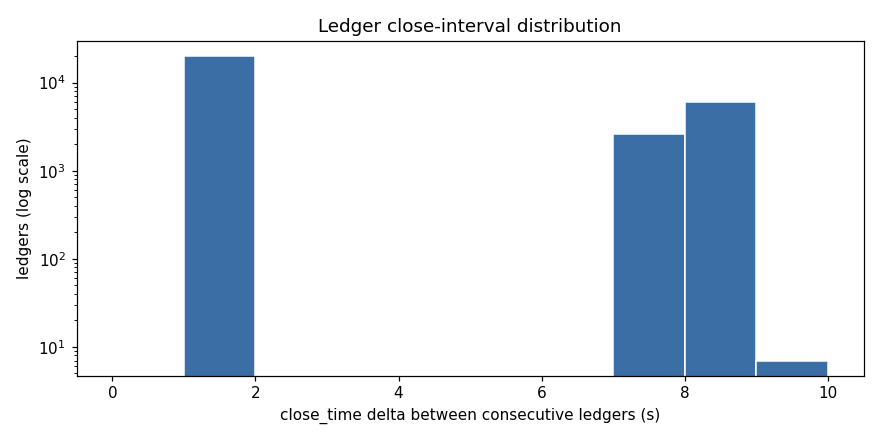
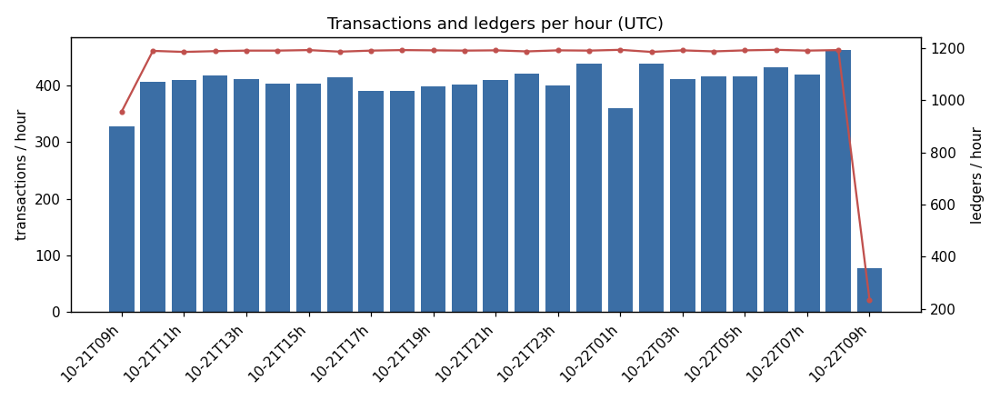
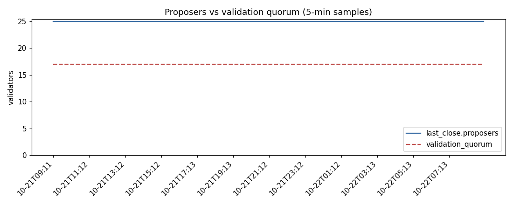

# Post Fiat testnet ledger health report

Single-node view, collected by `collect.py`, built by `analyze.py` from `data/`.

## Coverage

| item | value |
|---|---|
| ledger range | 7352333 – 7380888 |
| ledgers collected | 28556 |
| first close (UTC) | 2026-10-21T09:11:50Z |
| last close (UTC) | 2026-10-22T09:11:50Z |
| span | 86400 s (24.00 h) |
| gaps in ledger_index | 0  |
| skipped ledgers (skips.csv) | 0  |
| 5-min samples | 288 |
| close_time_resolution values seen | [10] s |

## Close intervals

`close_time` is rounded to `close_time_resolution`, so individual deltas are coarse (see README *Limits*). The mean is still accurate over a long window because rounding errors do not accumulate: mean = span / (ledgers − 1).

| min | median | p95 | p99 | max | mean |
|---|---|---|---|---|---|
| 1 | 1.00 | 8.00 | 8.00 | 9 | 3.026 |

## Stalls

Literal rule (card): interval > 3 × median raw delta = **3.00 s** → 8640 interval(s). The median raw delta is distorted by close_time rounding, so a resolution-aware rule is also reported: interval > 3 × max(median, close_time_resolution 10 s) = **30.00 s** → 0 interval(s).

### Resolution-aware stalls (0)

None.

### Literal 3 × median stalls (8640)

| ledger | close (UTC) | interval s |
|---|---|---|
| 7353950 | 2026-10-21T10:33:20Z | 9 |
| 7354563 | 2026-10-21T11:04:20Z | 9 |
| 7356425 | 2026-10-21T12:38:30Z | 9 |
| 7359695 | 2026-10-21T15:23:20Z | 9 |
| 7362299 | 2026-10-21T17:34:50Z | 9 |
| 7368316 | 2026-10-21T22:38:10Z | 9 |
| 7380848 | 2026-10-22T09:09:50Z | 9 |
| 7352336 | 2026-10-21T09:12:00Z | 8 |
| 7352339 | 2026-10-21T09:12:10Z | 8 |
| 7352346 | 2026-10-21T09:12:30Z | 8 |
| 7352349 | 2026-10-21T09:12:40Z | 8 |
| 7352356 | 2026-10-21T09:13:00Z | 8 |
| 7352359 | 2026-10-21T09:13:10Z | 8 |
| 7352366 | 2026-10-21T09:13:30Z | 8 |
| 7352369 | 2026-10-21T09:13:40Z | 8 |
| 7352376 | 2026-10-21T09:14:00Z | 8 |
| 7352379 | 2026-10-21T09:14:10Z | 8 |
| 7352386 | 2026-10-21T09:14:30Z | 8 |
| 7352389 | 2026-10-21T09:14:40Z | 8 |
| 7352396 | 2026-10-21T09:15:00Z | 8 |
| 7352399 | 2026-10-21T09:15:10Z | 8 |
| 7352406 | 2026-10-21T09:15:30Z | 8 |
| 7352409 | 2026-10-21T09:15:40Z | 8 |
| 7352416 | 2026-10-21T09:16:00Z | 8 |
| 7352419 | 2026-10-21T09:16:10Z | 8 |
| 7352426 | 2026-10-21T09:16:30Z | 8 |
| 7352429 | 2026-10-21T09:16:40Z | 8 |
| 7352436 | 2026-10-21T09:17:00Z | 8 |
| 7352439 | 2026-10-21T09:17:10Z | 8 |
| 7352446 | 2026-10-21T09:17:30Z | 8 |
| 7352449 | 2026-10-21T09:17:40Z | 8 |
| 7352456 | 2026-10-21T09:18:00Z | 8 |
| 7352459 | 2026-10-21T09:18:10Z | 8 |
| 7352462 | 2026-10-21T09:18:20Z | 8 |
| 7352469 | 2026-10-21T09:18:40Z | 8 |
| 7352472 | 2026-10-21T09:18:50Z | 8 |
| 7352479 | 2026-10-21T09:19:10Z | 8 |
| 7352482 | 2026-10-21T09:19:20Z | 8 |
| 7352489 | 2026-10-21T09:19:40Z | 8 |
| 7352492 | 2026-10-21T09:19:50Z | 8 |
| 7352499 | 2026-10-21T09:20:10Z | 8 |
| 7352502 | 2026-10-21T09:20:20Z | 8 |
| 7352509 | 2026-10-21T09:20:40Z | 8 |
| 7352512 | 2026-10-21T09:20:50Z | 8 |
| 7352519 | 2026-10-21T09:21:10Z | 8 |
| 7352522 | 2026-10-21T09:21:20Z | 8 |
| 7352529 | 2026-10-21T09:21:40Z | 8 |
| 7352532 | 2026-10-21T09:21:50Z | 8 |
| 7352535 | 2026-10-21T09:22:00Z | 8 |
| 7352542 | 2026-10-21T09:22:20Z | 8 |

(top 50 of 8640 shown, longest first; full list: `stalls.csv`)

## Transactions

Total 9858 transactions in 28556 ledgers; 23078 ledgers were empty.

| per ledger | min | median | p95 | p99 | max | mean |
|---|---|---|---|---|---|---|
| txns | 0 | 0.00 | 2.00 | 4.00 | 5 | 0.345 |

Full hours only (23):

| per hour | min | median | max | mean |
|---|---|---|---|---|
| txns | 359 | 410.00 | 461 | 411.0 |
| ledgers | 1185 | 1190.00 | 1193 | 1189.7 |

Hourly table

| hour (UTC) | ledgers | txns | burn (drops) |
|---|---|---|---|
| 2026-10-21T09 | 957 | 328 | 3264 |
| 2026-10-21T10 | 1189 | 406 | 4062 |
| 2026-10-21T11 | 1185 | 409 | 4098 |
| 2026-10-21T12 | 1188 | 417 | 4176 |
| 2026-10-21T13 | 1190 | 411 | 4120 |
| 2026-10-21T14 | 1190 | 402 | 4026 |
| 2026-10-21T15 | 1192 | 403 | 4036 |
| 2026-10-21T16 | 1186 | 414 | 4140 |
| 2026-10-21T17 | 1190 | 389 | 3894 |
| 2026-10-21T18 | 1192 | 390 | 3904 |
| 2026-10-21T19 | 1191 | 397 | 3978 |
| 2026-10-21T20 | 1190 | 401 | 4016 |
| 2026-10-21T21 | 1191 | 409 | 4094 |
| 2026-10-21T22 | 1187 | 420 | 4202 |
| 2026-10-21T23 | 1191 | 400 | 4000 |
| 2026-10-22T00 | 1190 | 438 | 4400 |
| 2026-10-22T01 | 1193 | 359 | 3594 |
| 2026-10-22T02 | 1185 | 437 | 4370 |
| 2026-10-22T03 | 1191 | 410 | 4100 |
| 2026-10-22T04 | 1187 | 415 | 4150 |
| 2026-10-22T05 | 1191 | 416 | 4162 |
| 2026-10-22T06 | 1193 | 431 | 4310 |
| 2026-10-22T07 | 1190 | 418 | 4182 |
| 2026-10-22T08 | 1192 | 461 | 4612 |
| 2026-10-22T09 | 235 | 77 | 770 |

## Fee burn (total_coins)

total_coins 99999999969737342 → 99999999969638682 drops: **98660 drops (0.098660 PFT) burned** over the window; 5477 ledgers burned fees, max in one ledger 50 drops.

## Proposers vs quorum

288 samples. proposers min 25 / max 25; quorum min 17 / max 17; margin (proposers − quorum) min 8, median 8.00; samples below quorum: 0. Trusted validators (UNL size) seen: [25]. Non-`full` server_state samples: 0.

## Cross-check against a second node (sentry)

| ledger | hash match | close_time match |
|---|---|---|
| 7380407 | yes | yes |
| 7380548 | yes | yes |
| 7380702 | yes | yes |
| 7380843 | yes | yes |
| 7380884 | yes | yes |

