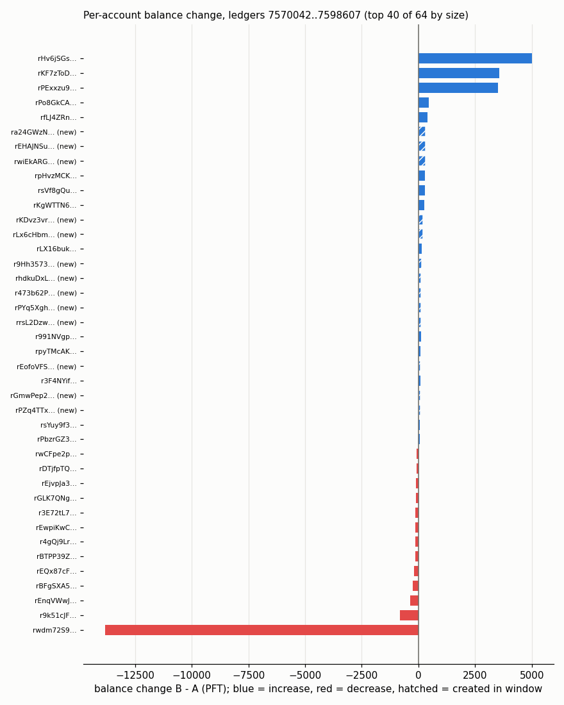

# acctchurn: account churn and funding between two ledger-state snapshots

- Snapshot A: ledger 7570042 (2026-10-29T00:08:11Z), 4926 objects, hash `02B1C39C…`
- Snapshot B: ledger 7598607 (2026-10-30T00:08:22Z), 4944 objects, hash `1A50B2D0…`
- Window: 28565 ledgers

## Objects by type

| Type | in A | in B | created | deleted | changed | unchanged |
|---|---:|---:|---:|---:|---:|---:|
| AccountRoot | 4408 | 4423 | 15 | 0 | 49 | 4359 |
| Amendments | 1 | 1 | 0 | 0 | 0 | 1 |
| DirectoryNode | 52 | 52 | 0 | 0 | 0 | 52 |
| FeeSettings | 1 | 1 | 0 | 0 | 0 | 1 |
| LedgerHashes | 117 | 117 | 0 | 0 | 2 | 115 |
| NFTokenOffer | 45 | 45 | 0 | 0 | 0 | 45 |
| NFTokenPage | 295 | 298 | 24 | 21 | 19 | 255 |
| Offer | 3 | 3 | 0 | 0 | 0 | 3 |
| RippleState | 4 | 4 | 0 | 0 | 0 | 4 |

## Native PFT conservation (exact, in drops)

| | A | B | B - A |
|---|---:|---:|---:|
| account_root | 99,999,999,968.988550 | 99,999,999,968.890094 | -0.098456 |
| escrow | 0.000000 | 0.000000 | 0.000000 |
| paychannel | 0.000000 | 0.000000 | 0.000000 |
| total | 99,999,999,968.988550 | 99,999,999,968.890094 | -0.098456 |
| total_coins (header) | 99,999,999,968.988550 | 99,999,999,968.890094 | -0.098456 |

Burned (total_coins A - B): 98456 drops.
Sum of fee_drops of every transaction in ledgers A+1..B: 98456 drops.

| Check | Result |
|---|---|
| burned_eq_fee_sum | PASS |
| delta_native_eq_minus_burned | PASS |
| native_a_eq_total_coins_a | PASS |
| native_b_eq_total_coins_b | PASS |
| net_balance_change_eq_delta_account_root | PASS |

## Created and deleted accounts

- Created: 15 (creating tx found for 15, not found 0)
- Deleted: 0
- Changed (same account, new state): 49
- Never active in the window (no tx sent after creation): 0 of 15
- Funding chains (a new account funded by another new account): 0
- Funded amount in base reserves: min 10.0, median 10.0, max 10.0
- Creating tx types: Payment 15

## Top 10 funders

| Funder | Accounts | Share | PFT sent to them |
|---|---:|---:|---:|
| `r9k51cJF…` | 15 | 100.0% | 1,500.000000 |

## Balance changes (every AccountRoot that differs; created from 0, deleted to 0)

| | PFT | accounts |
|---|---:|---:|
| gross increase | 16,844.655366 | 36 |
| gross decrease | -16,844.753822 | 28 |
| net | -0.098456 | 64 |
| changed, same balance | - | 0 |

Net equals the AccountRoot part of the native total, B - A (PASS).

Largest 10 changes:

| Account | Change (PFT) | Created in window |
|---|---:|---|
| `rwdm72S9…` | -13,830.180672 | no |
| `rHv6jSGs…` | 5,014.000000 | no |
| `rKF7zToD…` | 3,552.999976 | no |
| `rPExxzu9…` | 3,513.499988 | no |
| `r9k51cJF…` | -815.228112 | no |
| `rPo8GkCA…` | 454.000000 | no |
| `rfLJ4ZRn…` | 400.000000 | no |
| `rEnqVWwJ…` | -352.640169 | no |
| `ra24GWzN…` | 322.293699 | yes |
| `rEHAJNSu…` | 303.809313 | yes |

## RPC, crosschecks and tests

- funders (public RPC): 15 calls, 0 retries (by error: none)
- crosscheck: `SUMMARY checked=42 mismatches=0 sample=20 of pool=64 (created+changed) deleted=0 negative=False rpc_calls=42 retries=0 retries_by_error={}`
- crosscheck: `SUMMARY checked=42 mismatches=40 sample=20 of pool=64 (created+changed) deleted=0 negative=True rpc_calls=42 retries=0 retries_by_error={}`
- tests: 228 passed, ruff clean, mutants 10/10 caught (log 07)
