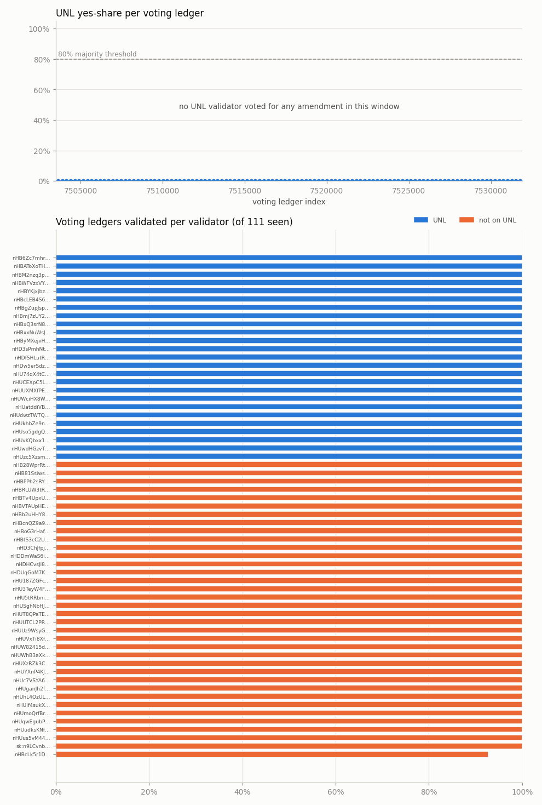

# govern report

- OS: Ubuntu 22.04.5 LTS; NTP synchronized: yes
- Window (UTC): 2026-10-26T16:10:36Z .. 2026-10-27T16:10:36Z
- Ledgers 28559 (7503448-7532006), collector sessions 1, gaps 0 (0 ledgers)
- Flag ledgers seen / expected: 111 / 111; voting ledgers seen / expected: 111 / 111
- Validators (master keys) with a validation on a voting ledger: 61; UNL size 25 (quorum 17), UNL members seen 25; UNL changed during window: False
- Vote entries 6763 (for a non-validated hash: 0; partial: 0); amendments voted for by anyone: 0; validators sending fee votes: 0

Single vantage point: a vote counts only if this node received the validation.

## Network

- Enabled amendments: 64 at the first flag ledger, 64 at the last
- Majorities at the last flag ledger: 0; appear/disappear events in window: 0
- UNL yes-share >= 80.0% on 0 of 111 voting ledgers
- FeeSettings states in window: from 7503616: BaseFee=a, ReferenceFeeUnits=10, ReserveBase=10000000, ReserveIncrement=2000000

## UNL tally per voting ledger

| voting ledger | UNL validations | amendments with yes votes | max UNL yes-share | >= 80% |
|---:|---:|---:|---:|---|
| 7503615 | 25/25 | 0 | 0.0% | - |
| 7503871 | 25/25 | 0 | 0.0% | - |
| 7504127 | 25/25 | 0 | 0.0% | - |
| 7504383 | 25/25 | 0 | 0.0% | - |
| 7504639 | 25/25 | 0 | 0.0% | - |
| 7504895 | 25/25 | 0 | 0.0% | - |
| 7505151 | 25/25 | 0 | 0.0% | - |
| 7505407 | 25/25 | 0 | 0.0% | - |
| 7505663 | 25/25 | 0 | 0.0% | - |
| 7505919 | 25/25 | 0 | 0.0% | - |
| 7506175 | 25/25 | 0 | 0.0% | - |
| 7506431 | 25/25 | 0 | 0.0% | - |
| 7506687 | 25/25 | 0 | 0.0% | - |
| 7506943 | 25/25 | 0 | 0.0% | - |
| 7507199 | 25/25 | 0 | 0.0% | - |
| 7507455 | 25/25 | 0 | 0.0% | - |
| 7507711 | 25/25 | 0 | 0.0% | - |
| 7507967 | 25/25 | 0 | 0.0% | - |
| 7508223 | 25/25 | 0 | 0.0% | - |
| 7508479 | 25/25 | 0 | 0.0% | - |
| 7508735 | 25/25 | 0 | 0.0% | - |
| 7508991 | 25/25 | 0 | 0.0% | - |
| 7509247 | 25/25 | 0 | 0.0% | - |
| 7509503 | 25/25 | 0 | 0.0% | - |
| 7509759 | 25/25 | 0 | 0.0% | - |
| 7510015 | 25/25 | 0 | 0.0% | - |
| 7510271 | 25/25 | 0 | 0.0% | - |
| 7510527 | 25/25 | 0 | 0.0% | - |
| 7510783 | 25/25 | 0 | 0.0% | - |
| 7511039 | 25/25 | 0 | 0.0% | - |
| 7511295 | 25/25 | 0 | 0.0% | - |
| 7511551 | 25/25 | 0 | 0.0% | - |
| 7511807 | 25/25 | 0 | 0.0% | - |
| 7512063 | 25/25 | 0 | 0.0% | - |
| 7512319 | 25/25 | 0 | 0.0% | - |
| 7512575 | 25/25 | 0 | 0.0% | - |
| 7512831 | 25/25 | 0 | 0.0% | - |
| 7513087 | 25/25 | 0 | 0.0% | - |
| 7513343 | 25/25 | 0 | 0.0% | - |
| 7513599 | 25/25 | 0 | 0.0% | - |
| 7513855 | 25/25 | 0 | 0.0% | - |
| 7514111 | 25/25 | 0 | 0.0% | - |
| 7514367 | 25/25 | 0 | 0.0% | - |
| 7514623 | 25/25 | 0 | 0.0% | - |
| 7514879 | 25/25 | 0 | 0.0% | - |
| 7515135 | 25/25 | 0 | 0.0% | - |
| 7515391 | 25/25 | 0 | 0.0% | - |
| 7515647 | 25/25 | 0 | 0.0% | - |
| 7515903 | 25/25 | 0 | 0.0% | - |
| 7516159 | 25/25 | 0 | 0.0% | - |
| 7516415 | 25/25 | 0 | 0.0% | - |
| 7516671 | 25/25 | 0 | 0.0% | - |
| 7516927 | 25/25 | 0 | 0.0% | - |
| 7517183 | 25/25 | 0 | 0.0% | - |
| 7517439 | 25/25 | 0 | 0.0% | - |
| 7517695 | 25/25 | 0 | 0.0% | - |
| 7517951 | 25/25 | 0 | 0.0% | - |
| 7518207 | 25/25 | 0 | 0.0% | - |
| 7518463 | 25/25 | 0 | 0.0% | - |
| 7518719 | 25/25 | 0 | 0.0% | - |
| 7518975 | 25/25 | 0 | 0.0% | - |
| 7519231 | 25/25 | 0 | 0.0% | - |
| 7519487 | 25/25 | 0 | 0.0% | - |
| 7519743 | 25/25 | 0 | 0.0% | - |
| 7519999 | 25/25 | 0 | 0.0% | - |
| 7520255 | 25/25 | 0 | 0.0% | - |
| 7520511 | 25/25 | 0 | 0.0% | - |
| 7520767 | 25/25 | 0 | 0.0% | - |
| 7521023 | 25/25 | 0 | 0.0% | - |
| 7521279 | 25/25 | 0 | 0.0% | - |
| 7521535 | 25/25 | 0 | 0.0% | - |
| 7521791 | 25/25 | 0 | 0.0% | - |
| 7522047 | 25/25 | 0 | 0.0% | - |
| 7522303 | 25/25 | 0 | 0.0% | - |
| 7522559 | 25/25 | 0 | 0.0% | - |
| 7522815 | 25/25 | 0 | 0.0% | - |
| 7523071 | 25/25 | 0 | 0.0% | - |
| 7523327 | 25/25 | 0 | 0.0% | - |
| 7523583 | 25/25 | 0 | 0.0% | - |
| 7523839 | 25/25 | 0 | 0.0% | - |
| 7524095 | 25/25 | 0 | 0.0% | - |
| 7524351 | 25/25 | 0 | 0.0% | - |
| 7524607 | 25/25 | 0 | 0.0% | - |
| 7524863 | 25/25 | 0 | 0.0% | - |
| 7525119 | 25/25 | 0 | 0.0% | - |
| 7525375 | 25/25 | 0 | 0.0% | - |
| 7525631 | 25/25 | 0 | 0.0% | - |
| 7525887 | 25/25 | 0 | 0.0% | - |
| 7526143 | 25/25 | 0 | 0.0% | - |
| 7526399 | 25/25 | 0 | 0.0% | - |
| 7526655 | 25/25 | 0 | 0.0% | - |
| 7526911 | 25/25 | 0 | 0.0% | - |
| 7527167 | 25/25 | 0 | 0.0% | - |
| 7527423 | 25/25 | 0 | 0.0% | - |
| 7527679 | 25/25 | 0 | 0.0% | - |
| 7527935 | 25/25 | 0 | 0.0% | - |
| 7528191 | 25/25 | 0 | 0.0% | - |
| 7528447 | 25/25 | 0 | 0.0% | - |
| 7528703 | 25/25 | 0 | 0.0% | - |
| 7528959 | 25/25 | 0 | 0.0% | - |
| 7529215 | 25/25 | 0 | 0.0% | - |
| 7529471 | 25/25 | 0 | 0.0% | - |
| 7529727 | 25/25 | 0 | 0.0% | - |
| 7529983 | 25/25 | 0 | 0.0% | - |
| 7530239 | 25/25 | 0 | 0.0% | - |
| 7530495 | 25/25 | 0 | 0.0% | - |
| 7530751 | 25/25 | 0 | 0.0% | - |
| 7531007 | 25/25 | 0 | 0.0% | - |
| 7531263 | 25/25 | 0 | 0.0% | - |
| 7531519 | 25/25 | 0 | 0.0% | - |
| 7531775 | 25/25 | 0 | 0.0% | - |

## Per-validator vote matrix

`voted` = voting ledgers validated here; `span` = voting ledgers in its active span; `yes` = amendments it voted for at least once (yes-share over the window / its span); `fee` = fee-vote values; `missing` = voting ledgers in span (UNL: whole window) without its validation.

| validator | UNL | build | voted | span | missing | yes (window / span) | changes | fee | flags |
|---|---|---|---:|---:|---:|---|---:|---|---|
| `nHB6Zc7mhr7swksE…` | yes | 1.0.9 | 111 | 111 | 0 | none | 0 | - | - |
| `nHBAToXoTH6eZtC1…` | yes | 1.0.9 | 111 | 111 | 0 | none | 0 | - | - |
| `nHBM2nzq3pZUg8Js…` | yes | 1.0.9 | 111 | 111 | 0 | none | 0 | - | - |
| `nHBWFVzxVYAVQNUF…` | yes | 1.0.9 | 111 | 111 | 0 | none | 0 | - | - |
| `nHBYKjxjbzxRzrS3…` | yes | 1.0.9 | 111 | 111 | 0 | none | 0 | - | - |
| `nHBcLEB4S6moQGrh…` | yes | 1.0.9 | 111 | 111 | 0 | none | 0 | - | - |
| `nHBgZupJspDsrg7m…` | yes | 1.0.9 | 111 | 111 | 0 | none | 0 | - | - |
| `nHBmj7zUY2yMc9f5…` | yes | 1.0.9 | 111 | 111 | 0 | none | 0 | - | - |
| `nHBxQ3srN8ErMvfM…` | yes | 1.0.9 | 111 | 111 | 0 | none | 0 | - | - |
| `nHBxxNuWsJXkzLk3…` | yes | 1.0.9 | 111 | 111 | 0 | none | 0 | - | - |
| `nHByMXejvHJgjcGJ…` | yes | 1.0.9 | 111 | 111 | 0 | none | 0 | - | - |
| `nHD3sPmhNtVXTXrZ…` | yes | 1.0.9 | 111 | 111 | 0 | none | 0 | - | - |
| `nHDfSHLutR7QqttA…` | yes | 1.0.9 | 111 | 111 | 0 | none | 0 | - | - |
| `nHDw5erSdzhtZ7kh…` | yes | 1.0.9 | 111 | 111 | 0 | none | 0 | - | - |
| `nHU74qX4tCQDSpE6…` | yes | 1.0.9 | 111 | 111 | 0 | none | 0 | - | - |
| `nHUCEXpC5LhFAm1M…` | yes | 1.0.9 | 111 | 111 | 0 | none | 0 | - | - |
| `nHUUXMXfPEdnKAT8…` | yes | 1.0.9 | 111 | 111 | 0 | none | 0 | - | - |
| `nHUWciHX8W9PgM3s…` | yes | 1.0.9 | 111 | 111 | 0 | none | 0 | - | - |
| `nHUatddiVB2GN6zH…` | yes | 1.0.9 | 111 | 111 | 0 | none | 0 | - | - |
| `nHUdwzTWTQJzebbx…` | yes | 1.0.9 | 111 | 111 | 0 | none | 0 | - | - |
| `nHUkhbZe9ncdmhn6…` | yes | 1.0.9 | 111 | 111 | 0 | none | 0 | - | - |
| `nHUso5gdgQnewAsk…` | yes | 1.0.9 | 111 | 111 | 0 | none | 0 | - | - |
| `nHUvKQbxx14GFyMa…` | yes | 1.0.9 | 111 | 111 | 0 | none | 0 | - | - |
| `nHUwdHGzvTM93oV3…` | yes | 1.0.9 | 111 | 111 | 0 | none | 0 | - | - |
| `nHUzc5XzsmweRV6a…` | yes | 1.0.9 | 111 | 111 | 0 | none | 0 | - | - |
| `nHB28WprRtLAhV9H…` | no | 1.0.4 | 111 | 111 | 0 | none | 0 | - | build-blocked-risk |
| `nHB81SsiwsituuAU…` | no | 1.0.8 | 111 | 111 | 0 | none | 0 | - | build-blocked-risk |
| `nHBPPh2sRYnJVRLu…` | no | 1.0.4 | 111 | 111 | 0 | none | 0 | - | build-blocked-risk |
| `nHBRLUW3tRVq1Lyv…` | no | 1.0.0 | 111 | 111 | 0 | none | 0 | - | build-blocked-risk |
| `nHBTv4UpxUn2TWcL…` | no | 1.0.4 | 111 | 111 | 0 | none | 0 | - | build-blocked-risk |
| `nHBVTAUpHEoEctXc…` | no | 1.0.9 | 111 | 111 | 0 | none | 0 | - | - |
| `nHBb2uHHY8V78qWQ…` | no | 1.0.9 | 111 | 111 | 0 | none | 0 | - | - |
| `nHBcLk5r1DVTpAGK…` | no | 1.0.4 | 103 | 111 | 8 | none | 0 | - | build-blocked-risk, missing-vote |
| `nHBcnQZ9a9UjZ7hb…` | no | 1.0.9 | 111 | 111 | 0 | none | 0 | - | - |
| `nHBoG3rHafA3U3Yf…` | no | 1.0.9 | 111 | 111 | 0 | none | 0 | - | - |
| `nHBtS3cC2UDzoSAN…` | no | 1.0.9 | 111 | 111 | 0 | none | 0 | - | - |
| `nHD3ChJfpjf9SwNx…` | no | 1.0.4 | 111 | 111 | 0 | none | 0 | - | build-blocked-risk |
| `nHDDmWaS6iP8HNJ6…` | no | 1.0.4 | 111 | 111 | 0 | none | 0 | - | build-blocked-risk |
| `nHDHCvsJi8UwHMAb…` | no | 1.0.4 | 111 | 111 | 0 | none | 0 | - | build-blocked-risk |
| `nHDUqGoM7KR1pgbd…` | no | 1.0.9 | 111 | 111 | 0 | none | 0 | - | - |
| `nHU187ZGFcGHbLPb…` | no | 1.0.4 | 111 | 111 | 0 | none | 0 | - | build-blocked-risk |
| `nHU3TeyW4FPHxjoP…` | no | 1.0.4 | 111 | 111 | 0 | none | 0 | - | build-blocked-risk |
| `nHU5tRRbniyStcsT…` | no | 1.0.4 | 111 | 111 | 0 | none | 0 | - | build-blocked-risk |
| `nHUSghNbHJoUbgAH…` | no | 1.0.9 | 111 | 111 | 0 | none | 0 | - | - |
| `nHUT8QPaTEVw7hmQ…` | no | 1.0.9 | 111 | 111 | 0 | none | 0 | - | - |
| `nHUUTCL2PRuNsRfc…` | no | 1.0.4 | 111 | 111 | 0 | none | 0 | - | build-blocked-risk |
| `nHUUz9WsyGPkNgEy…` | no | 1.0.9 | 111 | 111 | 0 | none | 0 | - | - |
| `nHUVxTi8XfXjaaJp…` | no | 1.0.9 | 111 | 111 | 0 | none | 0 | - | - |
| `nHUW82415dUNULY4…` | no | 1.0.9 | 111 | 111 | 0 | none | 0 | - | - |
| `nHUWhB3aXkJxWeRh…` | no | 1.0.4 | 111 | 111 | 0 | none | 0 | - | build-blocked-risk |
| `nHUXzRZk3CYqATxq…` | no | 1.0.4 | 111 | 111 | 0 | none | 0 | - | build-blocked-risk |
| `nHUYXnP4KJ8nSdKk…` | no | 1.0.4 | 111 | 111 | 0 | none | 0 | - | build-blocked-risk |
| `nHUc7VSYA6xvFakS…` | no | 1.0.9 | 111 | 111 | 0 | none | 0 | - | - |
| `nHUganJh2fSS4QxY…` | no | 1.0.4 | 111 | 111 | 0 | none | 0 | - | build-blocked-risk |
| `nHUhL4QzULuXt2WK…` | no | 1.0.9 | 111 | 111 | 0 | none | 0 | - | - |
| `nHUif4sukXu9pJGy…` | no | 1.0.9 | 111 | 111 | 0 | none | 0 | - | - |
| `nHUmoQrfBrSE3yjC…` | no | 1.0.4 | 111 | 111 | 0 | none | 0 | - | build-blocked-risk |
| `nHUqwEgubPGfXqAd…` | no | 1.0.4 | 111 | 111 | 0 | none | 0 | - | build-blocked-risk |
| `nHUudksKNfoJ9mLF…` | no | 1.0.4 | 111 | 111 | 0 | none | 0 | - | build-blocked-risk |
| `nHUus5vM4463rd82…` | no | 1.0.4 | 111 | 111 | 0 | none | 0 | - | build-blocked-risk |
| `sk:n9LCvnbesKjbV…` | no | 1.0.0 | 111 | 111 | 0 | none | 0 | - | build-blocked-risk |

## Vote changes

none

## Charts

