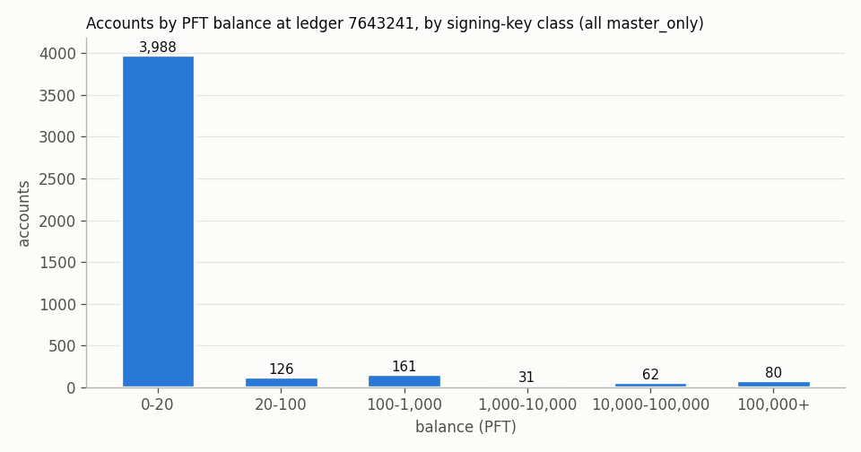

# keyposture: signing-key posture of every testnet account, ledger 7614111 -> 7643241

- Snapshot A: ledger 7614111 (closed 2026-10-30T13:10:43Z), hash `F727010F3F388DBF1DA10EB24F46C68A52ED58F4404FCFB501633E4AC761B2B6`
- Snapshot B: ledger 7643241 (closed 2026-10-31T13:41:30Z), hash `8938DBEF41C8AEAE6134BDF9D2A45BF18783D65AAC281C6C0838DA9E42C75A1F`
- Window: 29130 ledgers (A+1..B), 15 key-relevant transactions (Payment 15), 15 with a posture effect
- Accounts: 4433 at A, 4448 at B (15 created, 0 deleted); SignerList objects: 0 at A, 0 at B

## Reconciliation

Result: **PASS**, residuals: 0.

| class | A | in | out | A + in - out | B |
|---|---:|---:|---:|---:|---:|
| blackholed | 0 | 0 | 0 | 0 | 0 |
| master+multisig | 0 | 0 | 0 | 0 | 0 |
| master+regular | 0 | 0 | 0 | 0 | 0 |
| master+regular+multisig | 0 | 0 | 0 | 0 | 0 |
| master_only | 4433 | 15 | 0 | 4448 | 4448 |
| multisig_only | 0 | 0 | 0 | 0 | 0 |
| no_usable_key | 0 | 0 | 0 | 0 | 0 |
| regular+multisig | 0 | 0 | 0 | 0 | 0 |
| regular_only | 0 | 0 | 0 | 0 | 0 |

## Public-RPC crosscheck

- `SUMMARY checked=55 mismatches=0 accounts=20 required=16 effect_txs=15 negative=False rpc_calls=55 retries=0 retries_by_error={}`
- `--negative`: `SUMMARY checked=55 mismatches=55 accounts=20 required=16 effect_txs=15 negative=True rpc_calls=55 retries=0 retries_by_error={}`

## Classes, weak configurations, reward accounts and top balances

| class | A accounts | A share | B accounts | B share | B PFT | B PFT share |
|---|---:|---:|---:|---:|---:|---:|
| master_only | 4433 | 100.00% | 4448 | 100.00% | 99,999,999,968.735458 | 100.00% |
| master+regular | 0 | 0.00% | 0 | 0.00% | 0.000000 | 0.00% |
| master+multisig | 0 | 0.00% | 0 | 0.00% | 0.000000 | 0.00% |
| master+regular+multisig | 0 | 0.00% | 0 | 0.00% | 0.000000 | 0.00% |
| regular_only | 0 | 0.00% | 0 | 0.00% | 0.000000 | 0.00% |
| multisig_only | 0 | 0.00% | 0 | 0.00% | 0.000000 | 0.00% |
| regular+multisig | 0 | 0.00% | 0 | 0.00% | 0.000000 | 0.00% |
| blackholed | 0 | 0.00% | 0 | 0.00% | 0.000000 | 0.00% |
| no_usable_key | 0 | 0.00% | 0 | 0.00% | 0.000000 | 0.00% |

Weak configurations at B: none

Transitions A->B (created 15, deleted 0): (new) -> master_only: 15

| role | account | class A | class B | weak flags B | PFT at B |
|---|---|---|---|---|---:|
| payer | `rwdm72…` | master_only | master_only | - | 488,295,945.344478 |
| recipient | `r3F4NY…` | master_only | master_only | - | 1,017.499987 |
| recipient | `r4RPpe…` | master_only | master_only | - | 2,531,912.964183 |
| recipient | `r4XLZK…` | master_only | master_only | - | 923,817.607922 |
| recipient | `rDep8S…` | master_only | master_only | - | 1,215,759.009352 |
| recipient | `rHv6jS…` | master_only | master_only | - | 16,810.249963 |
| recipient | `rKF7zT…` | master_only | master_only | - | 1,115,477.825565 |
| recipient | `rPExxz…` | master_only | master_only | - | 72,144.949991 |
| recipient | `rPTCS8…` | master_only | master_only | - | 101,594.299892 |
| recipient | `rfLJ4Z…` | master_only | master_only | - | 1,499,691.493344 |
| recipient | `rpHvzM…` | master_only | master_only | - | 27,443.579988 |
| recipient | `rpq9nq…` | master_only | master_only | - | 3,572.000004 |
| recipient | `rsVf8g…` | master_only | master_only | - | 25,124.999837 |

Top balances at B, master_only: `r4vhrM…` 97,000,000,000.00, `rwdm72…` 488,295,945.34, `rscWPz…` 250,000,000.00, `rs3YdB…` 250,000,000.00, `rJNBxu…` 250,000,000.00, `rD9LaW…` 250,000,000.00, `rBDbRY…` 249,952,700.00, `rhczhW…` 249,714,196.43, `rKddMw…` 248,880,686.83, `rJNwqD…` 246,963,444.57

Weak-flag counts at A: none; at B: none.

Addresses are truncated here; the raw snapshots and `data/tx/key-tx.jsonl` keep full addresses (public ledger data).
