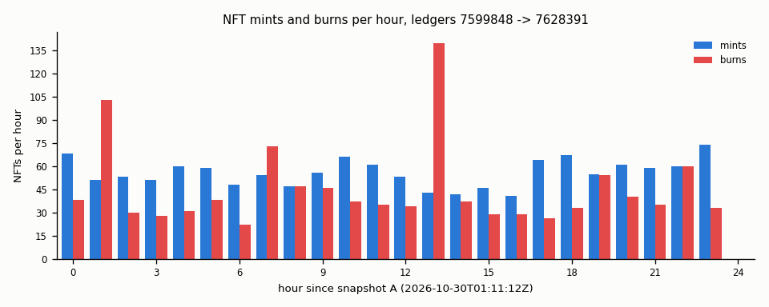

# nftflow: NFT lifecycle and supply reconciliation

- Snapshot A: ledger 7599848 (2026-10-30T01:11:12Z)
- Snapshot B: ledger 7628391 (2026-10-31T01:11:20Z)
- Window: 28543 ledgers (A+1..B), 2417 transactions touching NFTs

## Reconciliation

| Check | Result | Detail |
|---|---|---|
| R1 replayed A == B NFTokenID->owner map | PASS | 5159 live at B, 0 differences |
| R2 per-issuer and total supply | PASS | 4898 + 1339 - 1078 = 5159 over 160 issuers |
| R3 AccountRoot MintedNFTokens/BurnedNFTokens deltas | PASS | 3943 issuer accounts |
| R4 replayed A offers == B offers | PASS | 45 at A, 45 at B |
| R5 every minted NFTokenID is new | PASS | 1339 mints |

Residuals: 0. Live NFTs 4898 + mints 1339 - burns 1078 = 5159 (snapshot B: 5159).
Transfers (owner changed): 0. Page moves (same owner, other page; split or merge): 798. Mints with a URI: 1339 of 1339.
Mint field check (flags, fee, issuer, taxon of each minted ID vs its mint tx): 1339 mints, 0 mismatches.

## Hourly activity

| hour since A | mints | burns | transfers | offers created |
|---:|---:|---:|---:|---:|
| 0 | 68 | 38 | 0 | 0 |
| 1 | 51 | 103 | 0 | 0 |
| 2 | 53 | 30 | 0 | 0 |
| 3 | 51 | 28 | 0 | 0 |
| 4 | 60 | 31 | 0 | 0 |
| 5 | 59 | 38 | 0 | 0 |
| 6 | 48 | 22 | 0 | 0 |
| 7 | 54 | 73 | 0 | 0 |
| 8 | 47 | 47 | 0 | 0 |
| 9 | 56 | 46 | 0 | 0 |
| 10 | 66 | 37 | 0 | 0 |
| 11 | 61 | 35 | 0 | 0 |
| 12 | 53 | 34 | 0 | 0 |
| 13 | 43 | 140 | 0 | 0 |
| 14 | 42 | 37 | 0 | 0 |
| 15 | 46 | 29 | 0 | 0 |
| 16 | 41 | 29 | 0 | 0 |
| 17 | 64 | 26 | 0 | 0 |
| 18 | 67 | 33 | 0 | 0 |
| 19 | 55 | 54 | 0 | 0 |
| 20 | 61 | 40 | 0 | 0 |
| 21 | 59 | 35 | 0 | 0 |
| 22 | 60 | 60 | 0 | 0 |
| 23 | 74 | 33 | 0 | 0 |
| 24 | 0 | 0 | 0 | 0 |

Busiest hour: 13 (43 mints, 140 burns).

## Issuers

160 issuers have NFTs live at A or B or activity in the window; 49 minted or burned.

| Issuer (top 10 by mints + burns) | live A | live B | mints | burns | MintedNFTokens Δ | BurnedNFTokens Δ |
|---|---:|---:|---:|---:|---:|---:|
| `rwiEkARG…` | 70 | 134 | 118 | 54 | 118 | 54 |
| `rPYq5Xgh…` | 19 | 82 | 115 | 52 | 115 | 52 |
| `rPbzrGZ3…` | 109 | 171 | 109 | 47 | 109 | 47 |
| `rEHAJNSu…` | 3 | 1 | 66 | 68 | 66 | 68 |
| `ra24GWzN…` | 3 | 1 | 55 | 57 | 55 | 57 |
| `rDDkjGGD…` | 0 | 37 | 70 | 33 | 70 | 33 |
| `rmJPH8ch…` | 0 | 36 | 68 | 32 | 68 | 32 |
| `ra1ViaGu…` | 78 | 0 | 10 | 88 | 10 | 88 |
| `rGXWvRL2…` | 47 | 0 | 24 | 71 | 24 | 71 |
| `rrsL2Dzw…` | 5 | 0 | 42 | 47 | 42 | 47 |

## Flags, taxons, transfer fees

Population: 5833 NFTs (live at B plus minted in the window).

| flags | NFTs |
|---|---:|
| burnable+transferable | 4006 |
| none | 1696 |
| transferable | 131 |

Distinct (issuer, taxon) pairs: 1779.

| Issuer | taxon | NFTs (top 10) |
|---|---:|---:|
| `rfo5PXej…` | 0 | 386 |
| `rH3dfGif…` | 0 | 258 |
| `rnmLkDT2…` | 0 | 249 |
| `rsqZiJ6v…` | 0 | 236 |
| `rpyTMcAK…` | 0 | 186 |
| `rpc9Fcxt…` | 0 | 173 |
| `rs5gToNM…` | 0 | 156 |
| `rHTgM9rZ…` | 0 | 152 |
| `rQhV9rE7…` | 0 | 149 |
| `rKF7zToD…` | 0 | 143 |

| TransferFee | NFTs | share |
|---:|---:|---:|
| 0 | 5833 | 0.000% |

## NFT lifetime (mint -> burn)

- Minted and burned inside the window: 674; lifetime min 0h00m20s, median 2h20m59s, p90 11h38m51s, max 22h41m02s, mean 4h23m36s
- Burned in the window but minted before A (left-censored, no lifetime): 404
- Minted in the window and still live at B: 665

## Offers

- NFTokenOffer objects: 45 at A, 45 at B
- Created in the window: 0 (sell 0, buy 0)
- Fates of offers created in the window: {}
- Offers that existed at A and were deleted in the window: {}
- Create -> accept time: -

## NFTokenPage efficiency (max 32 tokens per page)

| | pages | tokens | mean fill | fill ratio | full pages | owners | owners with >1 page |
|---|---:|---:|---:|---:|---:|---:|---:|
| A | 299 | 4898 | 16.38 | 0.5119 | 8 | 146 | 36 |
| B | 314 | 5159 | 16.43 | 0.5134 | 7 | 147 | 40 |

| tokens per page | 1-8 | 9-16 | 17-24 | 25-32 |
|---|---:|---:|---:|---:|
| A | 79 | 29 | 132 | 59 |
| B | 81 | 28 | 148 | 57 |

## Verification runs

- `12-crosscheck.log`: `SUMMARY checked=181 mismatches=0 ledgers=7599848->7628391 mints=20/1339 burns=20/1078 transfers=0/0 owners=3/147 issuers=49 offers_live=20/45 offers_deleted=0/0 negative=False rpc_calls=177 retries=0 retries_by_error={}`
- `13-crosscheck-negative.log`: `SUMMARY checked=181 mismatches=181 ledgers=7599848->7628391 mints=20/1339 burns=20/1078 transfers=0/0 owners=3/147 issuers=49 offers_live=20/45 offers_deleted=0/0 negative=True rpc_calls=177 retries=0 retries_by_error={}`
- tests: `327 passed in 11.11s (full suite; nftflow 44)`
- mutants: `MUTANTS 19 caught=19 failed=0`
