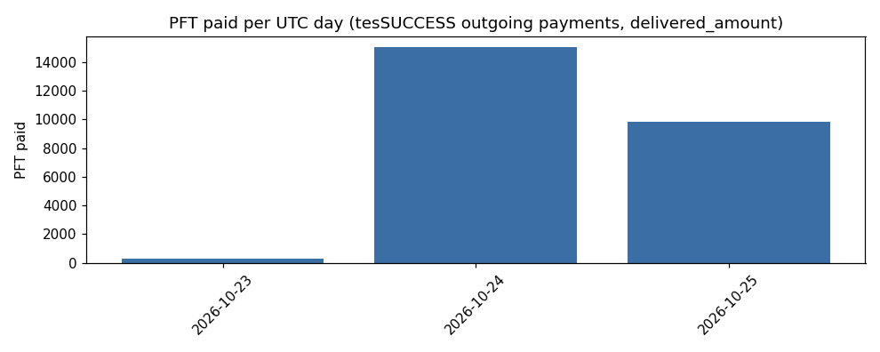
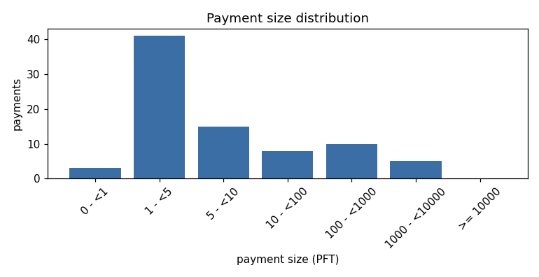
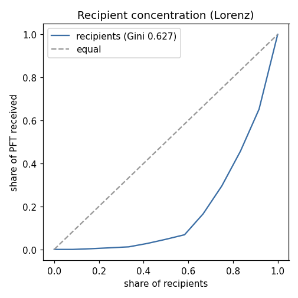

# rewardflow report: reward-payer PFT outflows

- Account: `rwdm72…` (truncated to 6 chars; full address in the collect log)
- Ledger range: 7400054-7467925 (server complete_ledgers `7400054-7467925` at collection start 2026-10-25T10:20:17Z), RPC https://rpc.testnet.postfiat.org
- Collection: complete, 83 account transactions, finished 2026-10-25T10:20:31Z
- First / last payment: 2026-10-23T01:23:32Z / 2026-10-25T10:11:30Z

## Totals

| metric | value |
|---|---|
| successful outgoing payments | 82 |
| PFT paid (sum of delivered_amount) | 25,158.150003 |
| unique recipients | 12 |
| failed outgoing payments (non-tesSUCCESS) | 0 |
| partial payments | 0 |
| fees paid on outgoing payments (PFT) | 0.000984 |
| other account transactions (not counted) | 1 {'in:Payment': 1} |

## Per day (UTC)

| day | payments | PFT paid |
|---|---|---|
| 2026-10-23 | 37 | 279.90 |
| 2026-10-24 | 27 | 15,023.50 |
| 2026-10-25 | 18 | 9,854.75 |

Per hour: 31 hours with at least one payment; busiest hour 2026-10-24T00:00Z (14,916.00 PFT); mean over active hours 811.55 PFT.

## Payment sizes (PFT)

p50 4.50 | p90 390.00 | p99 5,260.00 | max 8,500.00

Smallest: 0.000001 PFT (3 payments below 0.001 PFT).

| size bucket (PFT) | payments |
|---|---|
| 0 - <1 | 3 |
| 1 - <5 | 41 |
| 5 - <10 | 15 |
| 10 - <100 | 8 |
| 100 - <1000 | 10 |
| 1000 - <10000 | 5 |
| >= 10000 | 0 |

## Recipient concentration

- Top-10 share of PFT: 99.7%
- HHI (sum of squared shares, 0-1): 0.2126 (equal split over 12 recipients would be 0.0833)
- Gini over recipient totals: 0.627
- Repeat-recipient rate (recipients paid more than once): 91.7%

| recipient | payments | PFT |
|---|---|---|
| `rPTCS8` | 2 | 8,750.00 |
| `rPExxz` | 8 | 4,918.10 |
| `rpHvzM` | 23 | 4,063.00 |
| `rKF7zT` | 15 | 3,256.00 |
| `rHv6jS` | 14 | 2,453.75 |
| `rsVf8g` | 5 | 530.00 |
| `r4RPpe` | 6 | 487.30 |
| `rpq9nq` | 2 | 400.00 |
| `r3F4NY` | 2 | 110.00 |
| `rDep8S` | 2 | 105.00 |

## Inter-payment gaps (seconds between consecutive successful payments)

n=81 | p50 1,170 | p90 6,010 | p99 22,338 | max 42,479 (11.8 h)

## Memos

Decoded MemoType / MemoFormat, and `kind` = first `<word>_<id>` token found in MemoData (category only; MemoData itself is not published).

| MemoType | MemoFormat | kind | payments |
|---|---|---|---|
| pf.ptr | v4 | task | 60 |
| pf.ptr | v4 | airdrop | 22 |

## Charts

Generated by `rewardflow/analyze_rewardflow.py`; method and limits in `rewardflow/README.md`.
