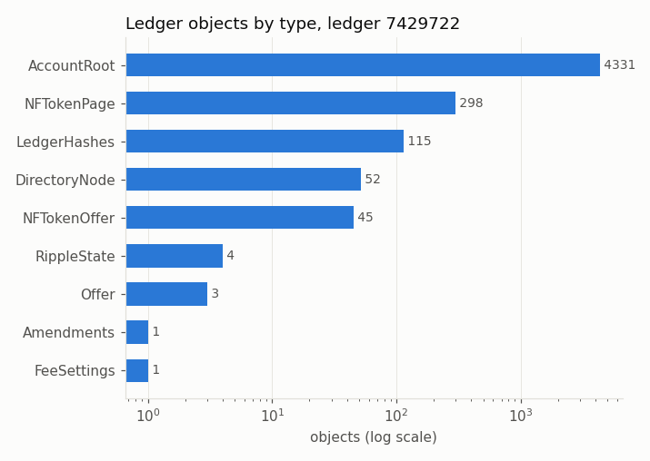
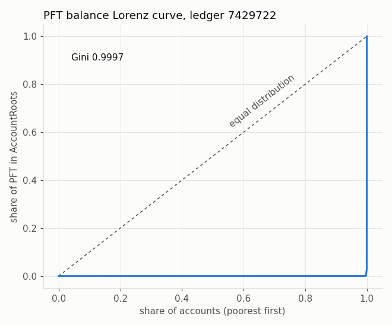

# Post Fiat ledger-state snapshot — ledger 7429722

- ledger_hash `8317F239C503E9097A15B6651CCEA99CDEE1A8F35F6E6E599C30B8A4AF08F953`
- account_hash `B0375A49207F7F911234F64B18EF89D1E49A75B28E88CFB30669085339C0D4B6`
- close time 2026-10-24T02:14:20Z; 4850 objects paged with `ledger_data` (binary=false) from a local testnet node's admin RPC

## Objects by LedgerEntryType

| LedgerEntryType | objects | share |
|---|---:|---:|
| AccountRoot | 4331 | 89.2990% |
| NFTokenPage | 298 | 6.1443% |
| LedgerHashes | 115 | 2.3711% |
| DirectoryNode | 52 | 1.0722% |
| NFTokenOffer | 45 | 0.9278% |
| RippleState | 4 | 0.0825% |
| Offer | 3 | 0.0619% |
| Amendments | 1 | 0.0206% |
| FeeSettings | 1 | 0.0206% |

Sum of type counts 4850 = objects paged 4850 = lines in snapshot 4850: **OK**

## PFT balances (4331 accounts)

| stat | PFT |
|---|---:|
| total in AccountRoots | 99,999,999,969.468887 |
| min | 9.999832 |
| median | 14.999990 |
| p90 | 24.999938 |
| p99 | 626,470.066011 |
| max | 96,999,999,999.999878 |
| mean | 23,089,355.799924 |

- top-10 accounts hold **99.4839%**, top-100 hold **99.9990%**
- Gini coefficient **0.9997** (0 = equal, 1 = one account holds everything)

## Reserve-locked vs spendable

Reserve = 10.000000 base + 2.000000 x OwnerCount (from FeeSettings; server_state at pin time: 10.000000 / 2.000000, match). Locked = min(Balance, reserve).

| | PFT | share |
|---|---:|---:|
| reserve-locked | 44,009.999768 | 0.000044% |
| spendable | 99,999,955,959.469116 | 99.999956% |

6 accounts hold less than their own reserve.

## OwnerCount buckets

| OwnerCount | accounts |
|---|---:|
| 0 | 4185 |
| 1 | 105 |
| 2-4 | 24 |
| 5-9 | 13 |
| 10-24 | 3 |
| 25-99 | 1 |
| 100+ | 0 |

## Per-holder objects

Trust lines count once for each side; offers = Offer + NFTokenOffer; other = NFTokenPage (by its
owner prefix), owner DirectoryNodes and any other object with an Account/Owner field.

| kind | accounts with any | objects | max per account | median among holders | 1 | 2-4 | 5-9 | 10-49 | 50+ |
|---|---:|---:|---:|---:|---:|---:|---:|---:|---:|
| lines | 5 | 8 | 4 | 1 | 4 | 1 | 0 | 0 | 0 |
| offers | 2 | 48 | 41 | 24 | 0 | 0 | 1 | 1 | 0 |
| other | 147 | 305 | 16 | 1 | 106 | 25 | 13 | 3 | 0 |

Owner keys that have no AccountRoot in this ledger: 0 (these are left out of the per-holder table).

## total_coins vs sum of balances

| | drops |
|---|---:|
| ledger header total_coins | 99999999969468888 |
| sum of AccountRoot Balance | 99999999969468888 |
| difference | 0 |

total_coins equals the PFT in AccountRoots plus the PFT held in Escrow/PayChannel objects (this ledger has no PFT in either): every drop is accounted for. Fees are burned, so total_coins only falls over time.
