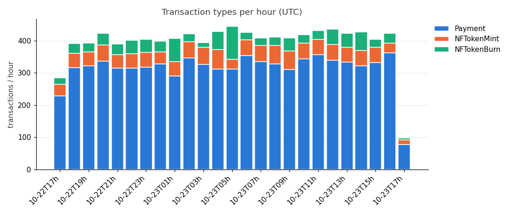
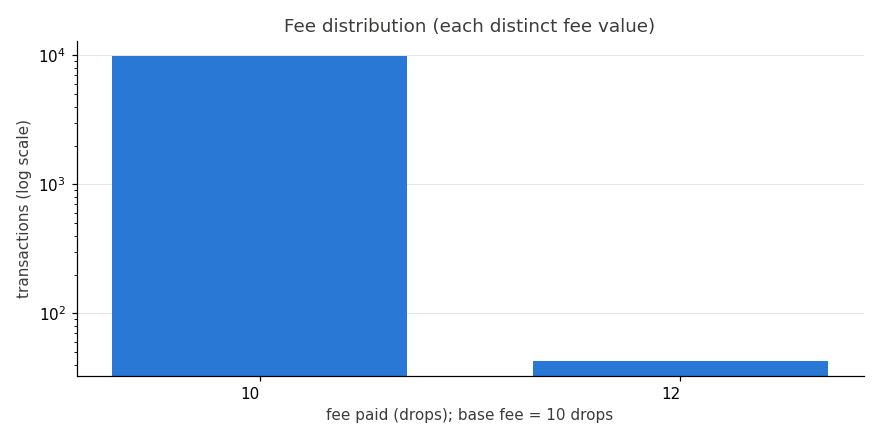
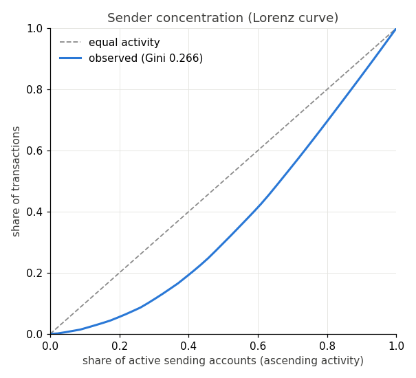

# txmix — Post Fiat testnet transaction mix

Window: **2026-10-22T17:14:22Z → 2026-10-23T17:14:22Z** (UTC), single node's validated-ledger view, testnet only.  
Ledgers observed: **28561** (7390454–7419014), gaps: **0**, empty ledgers: 23194 (81.2%).  
Transactions: **9890** after de-duplication by tx_hash (0 duplicate rows dropped); 0.35 tx/ledger.  
Base fee: 10 drops (server_info samples: 10).

Generated by `txmix/analyze_tx.py` from data collected by `txmix/collect_tx.py`.

## Transaction-type mix

| type | tx | share | tes | tec | other classes | memo | new accounts |
|---|---:|---:|---:|---:|---:|---:|---:|
| Payment | 7857 | 79.4% | 7851 | 6 | 0 | 43 | 14 |
| NFTokenMint | 1128 | 11.4% | 1128 | 0 | 0 | 0 | 0 |
| NFTokenBurn | 905 | 9.2% | 905 | 0 | 0 | 0 | 0 |

### Per UTC hour

| hour (UTC) | total | Payment | NFTokenMint | NFTokenBurn |
|---|---:|---:|---:|---:|
| 10-22T17h | 284 | 228 | 36 | 20 |
| 10-22T18h | 391 | 316 | 45 | 30 |
| 10-22T19h | 392 | 322 | 43 | 27 |
| 10-22T20h | 423 | 337 | 49 | 37 |
| 10-22T21h | 390 | 315 | 41 | 34 |
| 10-22T22h | 401 | 315 | 45 | 41 |
| 10-22T23h | 404 | 318 | 46 | 40 |
| 10-23T00h | 398 | 328 | 37 | 33 |
| 10-23T01h | 407 | 290 | 45 | 72 |
| 10-23T02h | 421 | 347 | 50 | 24 |
| 10-23T03h | 394 | 326 | 53 | 15 |
| 10-23T04h | 429 | 312 | 61 | 56 |
| 10-23T05h | 445 | 312 | 30 | 103 |
| 10-23T06h | 426 | 353 | 49 | 24 |
| 10-23T07h | 408 | 335 | 50 | 23 |
| 10-23T08h | 411 | 327 | 58 | 26 |
| 10-23T09h | 408 | 311 | 57 | 40 |
| 10-23T10h | 418 | 343 | 49 | 26 |
| 10-23T11h | 432 | 357 | 47 | 28 |
| 10-23T12h | 435 | 339 | 49 | 47 |
| 10-23T13h | 422 | 333 | 47 | 42 |
| 10-23T14h | 427 | 322 | 48 | 57 |
| 10-23T15h | 404 | 332 | 48 | 24 |
| 10-23T16h | 422 | 362 | 31 | 29 |
| 10-23T17h | 98 | 77 | 14 | 7 |

The first and last rows are partial hours: the window runs 17:14 to 17:14 UTC, so compare per-hour counts only between the full hours in between.

## Result codes

Non-tesSUCCESS results: **6** (0.1%). Validated ledgers only contain tes/tec results; tef/tel/tem/ter rows would indicate a collector bug and are shown if present.

| type | result | count | share of type |
|---|---|---:|---:|
| Payment | tesSUCCESS | 7851 | 99.9% |
| Payment | tecUNFUNDED_PAYMENT | 6 | 0.1% |
| NFTokenMint | tesSUCCESS | 1128 | 100.0% |
| NFTokenBurn | tesSUCCESS | 905 | 100.0% |

## Fees

| p50 | p90 | p99 | max | min | at base fee | above 10× base (> 100) | total burned |
|---:|---:|---:|---:|---:|---:|---:|---:|
| 10 | 10 | 10 | 12 | 10 | 99.6% | 0 (0.0%) | 98986 drops (0.098986 PFT) |

Drops; nearest-rank percentiles.

| type | p50 | p99 | max |
|---|---:|---:|---:|
| Payment | 10 | 10 | 12 |
| NFTokenMint | 10 | 10 | 10 |
| NFTokenBurn | 10 | 10 | 10 |

## Account activity

Active sending accounts: **46**. Top-10 senders: **33.0%** of transactions. Gini of tx count per sender: **0.266**.  
Busiest sender: 335 tx; median sender: 245 tx; senders with exactly 1 tx: 0.  
Accounts are HMAC-SHA256 tokens with a private per-run key, so no addresses are published and tokens cannot be linked across runs.

| sender rank | tx | share |
|---:|---:|---:|
| 1 | 335 | 3.4% |
| 2 | 335 | 3.4% |
| 3 | 332 | 3.4% |
| 4 | 328 | 3.3% |
| 5 | 328 | 3.3% |
| 6 | 324 | 3.3% |
| 7 | 323 | 3.3% |
| 8 | 323 | 3.3% |
| 9 | 321 | 3.2% |
| 10 | 319 | 3.2% |

## Newly funded accounts, memos, multisig, delivered amounts

- New AccountRoot objects created: **14** (Payment 14).
- Transactions with Memos: **43** (0.4%).
- Multi-signed transactions (Signers present): **0** (0.0%).
- delivered_amount class: native 7851, none 2039.

## Limits

- One node's view of validated ledgers on the Post Fiat **testnet**; mainnet behaviour may differ.
- Only validated, included transactions are seen: rejected/queued transactions (tef/tel/tem/ter) never reach a ledger.
- `account` is the sending account only; destinations are not recorded, so the Gini is sender-side.
- Chart colours: reference categorical palette slots 1-6 in fixed order, 'Other' in neutral gray; every chart has its numbers in a table above.
