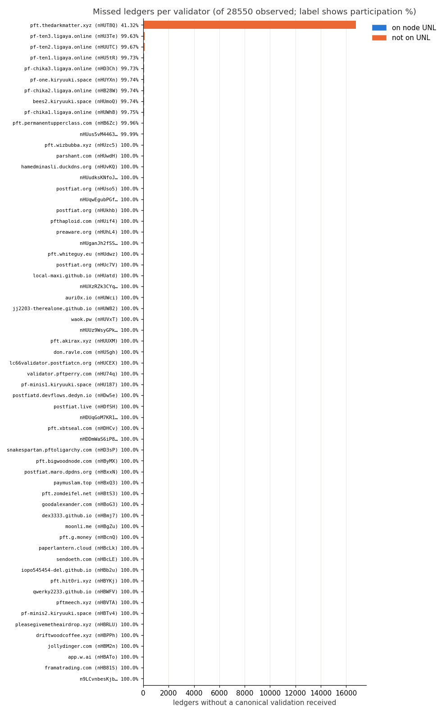
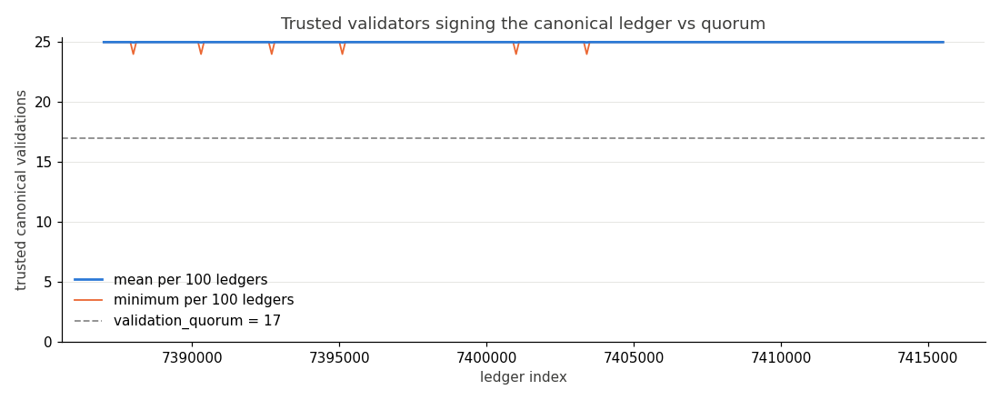
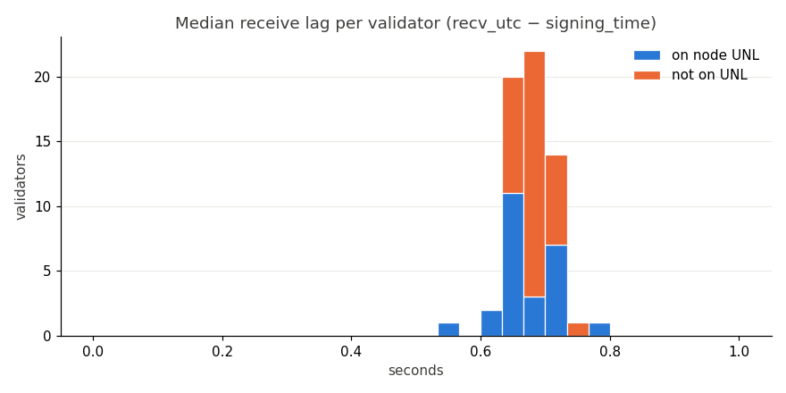

# Per-validator participation — Post Fiat testnet

Window: **2026-10-22T14:20:11Z → 2026-10-23T14:20:11Z** (UTC), one node's view (validations relayed to it), testnet only.  
Ledgers observed: **28550** (7387008–7415557); gap ledgers excluded: **0** in 0 gap(s).  
Validation rows: 1724180; validators seen or trusted: 61.  
Node UNL: 25 trusted keys, validation_quorum 17.

Generated by `validators/analyze_validations.py` from data collected by `validators/collect_validations.py`. Identities are public master keys and manifest domains only.

## UNL vs non-UNL

| group | validators | median participation % | lowest % | canonical validations |
|---|---:|---:|---:|---:|
| on node UNL | 25 | 100.0 | 99.96 | 713738 |
| not on UNL | 36 | 100.0 | 41.32 | 1010396 |

## Validators per ledger vs quorum

Trusted canonical validations per ledger: min 24, median 25.0, max 25 (quorum 17).  
Ledgers below quorum in this node's view: **0**.

A ledger "below quorum" here means this node *received* fewer trusted validations for the canonical hash than the quorum; the network still validated it (it is in the node's validated stream).

## Churn (first/last seen more than 100 ledgers inside the window)

- Joined during window: 1
  - `pft.thedarkmatter.xyz (nHUT8Q)` first 7403760
- Left during window: 0
- Trusted but never seen: 0
- UNL changes between first and last `validators` snapshot: added 0, removed 0

## Charts

## Per-validator table

Sign delay = median `signing_time` − ledger close time (1 s resolution). Receive lag = median arrival at this node − `signing_time` (relay latency plus clock skew).

Participation % uses every observed ledger in the window; active % uses only observed ledgers between the validator's first and last validation seen, so a validator that joined or left mid-window is not penalised there for ledgers before or after it existed (see Churn).

| validator | UNL | participation % | active % | missed | longest streak | non-canonical | sign delay s | recv lag s | first | last |
|---|---|---:|---:|---:|---:|---:|---:|---:|---:|---:|
| pft.permanentupperclass.com `nHB6Zc7mhr7swksEgpwTE7Hw7SvZ9cz22T2MECMSXjBeMTeHXQB7` | yes | 99.96 | 99.96 | 12 | 2 | 0 | 0.0 | 0.635 | 7387008 | 7415557 |
| app.w.ai `nHBAToXoTH6eZtC1cMJDvjG7eRb7ufZ3GUpeisvNVT4ofruRdVvd` | yes | 100.0 | 100.0 | 0 | 0 | 0 | 1.0 | 0.697 | 7387008 | 7415557 |
| jollydinger.com `nHBM2nzq3pZUg8JsxvEt3G7gAAtc5Sukaef6YmvVx64uAoRK4QWM` | yes | 100.0 | 100.0 | 0 | 0 | 0 | 1.0 | 0.54 | 7387008 | 7415557 |
| qwerky2233.github.io `nHBWFVzxVYAVQNUFHoqnHw2SWhXKy1kKRr7oYAMFeu22rqsCLYCN` | yes | 100.0 | 100.0 | 0 | 0 | 0 | 1.0 | 0.632 | 7387008 | 7415557 |
| pft.hit0ri.xyz `nHBYKjxjbzxRzrS3XkhpgM7KXJ25jbgPHkbAjjSCQPm8PaPS5y4v` | yes | 100.0 | 100.0 | 0 | 0 | 0 | 1.0 | 0.654 | 7387008 | 7415557 |
| sendoeth.com `nHBcLEB4S6moQGrhMjJo1jbp58WL5psHY9EMDWNAtdqykUYiA1rF` | yes | 100.0 | 100.0 | 0 | 0 | 0 | 1.0 | 0.638 | 7387008 | 7415557 |
| moonli.me `nHBgZupJspDsrg7mex4Z2vBQXqoN2aTHaLgf8jGxMDPw4MWLh3J6` | yes | 100.0 | 100.0 | 0 | 0 | 0 | 1.0 | 0.658 | 7387008 | 7415557 |
| dex3333.github.io `nHBmj7zUY2yMc9f5wgNcCuWj79BUieNmc1GG8PqiEP1tgNZZWLVM` | yes | 100.0 | 100.0 | 0 | 0 | 0 | 1.0 | 0.656 | 7387008 | 7415557 |
| paymuslam.top `nHBxQ3srN8ErMvfMgsJ3jycSSaMFyHMk5WbrJVUTXPZgNh1VdbHH` | yes | 100.0 | 100.0 | 0 | 0 | 0 | 1.0 | 0.702 | 7387008 | 7415557 |
| postfiat.maro.dpdns.org `nHBxxNuWsJXkzLk332ADxt1T18N1e9BSYjekjGNVCPfV813tSdvx` | yes | 100.0 | 100.0 | 0 | 0 | 0 | 1.0 | 0.696 | 7387008 | 7415557 |
| pft.bigwoodnode.com `nHByMXejvHJgjcGJ1f9bhcAGcFeNR6ecsDmzN4t3HkhyRHZtM6Lj` | yes | 100.0 | 100.0 | 0 | 0 | 0 | 1.0 | 0.665 | 7387008 | 7415557 |
| snakespartan.pftoligarchy.com `nHD3sPmhNtVXTXrZAGhsfHRhxhzFXKHNNxemTtGFr69SRd9q88dZ` | yes | 100.0 | 100.0 | 0 | 0 | 0 | 1.0 | 0.704 | 7387008 | 7415557 |
| postfiat.live `nHDfSHLutR7QqttAkx3AiYG2bukCdfAa3P9hrYL4yNJZQpvEpW1A` | yes | 100.0 | 100.0 | 0 | 0 | 0 | 1.0 | 0.703 | 7387008 | 7415557 |
| postfiatd.devflows.dedyn.io `nHDw5erSdzhtZ7khjHeotRywM6WyPgJp6sUSewscoqLgC6LGATzn` | yes | 100.0 | 100.0 | 0 | 0 | 0 | 1.0 | 0.641 | 7387008 | 7415557 |
| validator.pftperry.com `nHU74qX4tCQDSpE6zBS5PB3jybuGZJ7QMbeyLWDQRy3Lhb4DYDSR` | yes | 100.0 | 100.0 | 0 | 0 | 0 | 1.0 | 0.714 | 7387008 | 7415557 |
| lc66validator.postfiatcn.org `nHUCEXpC5LhFAm1Mmf8TqrzVGt3QCuwWoW2V8PYynDpjZe8m8mHj` | yes | 100.0 | 100.0 | 0 | 0 | 0 | 1.0 | 0.7 | 7387008 | 7415557 |
| pft.akirax.xyz `nHUUXMXfPEdnKAT8u2AB89LxTWT1tWsTecDPQURoMw2XJ2WP85MK` | yes | 100.0 | 100.0 | 0 | 0 | 0 | 1.0 | 0.619 | 7387008 | 7415557 |
| auri0x.io `nHUWciHX8W9PgM3sQmgkRiKpkuaJjTxFSyvZce4bP4WeMz81HefX` | yes | 100.0 | 100.0 | 0 | 0 | 0 | 1.0 | 0.704 | 7387008 | 7415557 |
| local-maxi.github.io `nHUatddiVB2GN6zHHCk1gtepjANF8BdjPKuVcN6jwG2JwBYPea3k` | yes | 100.0 | 100.0 | 0 | 0 | 0 | 1.0 | 0.72 | 7387008 | 7415557 |
| pft.whiteguy.eu `nHUdwzTWTQJzebbxcanZG2ERXikMLU9aAZa8cHtxosfiKq5N7Vd5` | yes | 100.0 | 100.0 | 0 | 0 | 0 | 1.0 | 0.665 | 7387008 | 7415557 |
| postfiat.org `nHUkhbZe9ncdmhn6dbd5x7391ymwCS3YZEMWjysP9fSiDtau9YEe` | yes | 100.0 | 100.0 | 0 | 0 | 0 | 1.0 | 0.636 | 7387008 | 7415557 |
| postfiat.org `nHUso5gdgQnewAsk5QT1aFr897g6YLaL697iyuknmSqd7pbqz5Td` | yes | 100.0 | 100.0 | 0 | 0 | 0 | 1.0 | 0.643 | 7387008 | 7415557 |
| hamedminasli.duckdns.org `nHUvKQbxx14GFyMaRB4vgu11x6pXrwMwX9yP5Ltgk4jp4SHbbgWA` | yes | 100.0 | 100.0 | 0 | 0 | 0 | 1.0 | 0.692 | 7387008 | 7415557 |
| parshant.com `nHUwdHGzvTM93oV38tMPSWZAWQ2Q6hVDS3XLQ32HPTUtcRASpayQ` | yes | 100.0 | 100.0 | 0 | 0 | 0 | 1.0 | 0.663 | 7387008 | 7415557 |
| pft.wizbubba.xyz `nHUzc5XzsmweRV6aNyUQJD5eRUM4TT4tVCBv5DKx6T7Buq4gn9Lr` | yes | 100.0 | 100.0 | 0 | 0 | 0 | 1.0 | 0.775 | 7387008 | 7415557 |
| pft.thedarkmatter.xyz `nHUT8QPaTEVw7hmQiKr7XTvgzrLMvGPGgv2xfdfLvRYpdyRJt5XE` | no | 41.32 | 100.0 | 16752 | 16752 | 0 | 1.0 | 0.712 | 7403760 | 7415557 |
| pf-ten3.ligaya.online `nHU3TeyW4FPHxjoP1PoF4Ak5VMc8ABwrrzKjBww7rYA9PKdPoSCN` | no | 99.63 | 99.63 | 106 | 38 | 4 | 1.0 | 0.675 | 7387008 | 7415557 |
| pf-ten2.ligaya.online `nHUUTCL2PRuNsRfcbtsSL6z4DJx4fvHNciiVcqeP1fLK8LCEf5C2` | no | 99.67 | 99.67 | 94 | 36 | 6 | 1.0 | 0.689 | 7387008 | 7415557 |
| pf-chika3.ligaya.online `nHD3ChJfpjf9SwNxiWhUG6VKGyWLHcGaU6WKZR4JHZFWxYoLNyf2` | no | 99.73 | 99.73 | 77 | 36 | 6 | 1.0 | 0.676 | 7387008 | 7415557 |
| pf-ten1.ligaya.online `nHU5tRRbniyStcsTe8HbCnyREyQ9Es5KpVGvfyub6haQ5eC9hqr5` | no | 99.73 | 99.73 | 78 | 36 | 6 | 1.0 | 0.674 | 7387008 | 7415557 |
| pf-chika2.ligaya.online `nHB28WprRtLAhV9H6mvhsUH181K3HGgYjoKaEKq3BdtJCUxYLGUU` | no | 99.74 | 99.74 | 75 | 36 | 6 | 1.0 | 0.678 | 7387008 | 7415557 |
| pf-one.kiryuuki.space `nHUYXnP4KJ8nSdKkbQFfzUZrQyxbzwCUrxmW1uLmoD8XYzCYY5Qr` | no | 99.74 | 99.74 | 75 | 36 | 6 | 1.0 | 0.681 | 7387008 | 7415557 |
| bees2.kiryuuki.space `nHUmoQrfBrSE3yjCtk5ZrCUTqwKCLv6t6SgK9oCuuMkoExEYxc8i` | no | 99.74 | 99.74 | 73 | 36 | 6 | 1.0 | 0.693 | 7387008 | 7415557 |
| pf-chika1.ligaya.online `nHUWhB3aXkJxWeRhPzBeE1Vqhz3FiGHGHfnCkJ7Ak5vrrYWaeqZh` | no | 99.75 | 99.75 | 72 | 36 | 4 | 1.0 | 0.677 | 7387008 | 7415557 |
| `nHUus5vM4463rd82Ws3YpcrREVrjHTBdoYgA6BdwDR3YcBiwG6hN` | no | 99.99 | 99.99 | 2 | 2 | 0 | 1.0 | 0.643 | 7387008 | 7415557 |
| `n9LCvnbesKjbVgyWQCkGXAHsGP492hr9T9sTNKu7pCWPve5Si45m` | no | 100.0 | 100.0 | 0 | 0 | 0 | 0.0 | 0.697 | 7387008 | 7415557 |
| framatrading.com `nHB81SsiwsituuAUrSx2j6kho5YdY5AwQ6SZLSqEiAKhzUQVHq53` | no | 100.0 | 100.0 | 0 | 0 | 0 | 1.0 | 0.681 | 7387008 | 7415557 |
| driftwoodcoffee.xyz `nHBPPh2sRYnJVRLud9mTp4292VNiFWYRkGTaE4AsqVUFLxZxMtxN` | no | 100.0 | 100.0 | 0 | 0 | 0 | 1.0 | 0.668 | 7387008 | 7415557 |
| pleasegivemetheairdrop.xyz `nHBRLUW3tRVq1LyvSV6atV3xYbdnw6rigRi6rNwSGFCBnkTAyj3o` | no | 100.0 | 100.0 | 0 | 0 | 0 | 1.0 | 0.69 | 7387008 | 7415557 |
| pf-minis2.kiryuuki.space `nHBTv4UpxUn2TWcLQHkKPWtycNXkbFeggFmbXtQYRd6kq5XH2J4B` | no | 100.0 | 100.0 | 0 | 0 | 0 | 1.0 | 0.653 | 7387008 | 7415557 |
| pftmeech.xyz `nHBVTAUpHEoEctXcAWyC7nJhxUYULWKz1WZCuC1tSm2VnCxDshVS` | no | 100.0 | 100.0 | 0 | 0 | 0 | 1.0 | 0.636 | 7387008 | 7415557 |
| iopo545454-del.github.io `nHBb2uHHY8V78qWQT3P6ADkFz4pRyEgJpA2pEqmQyTHuxXHccBzM` | no | 100.0 | 100.0 | 0 | 0 | 0 | 0.0 | 0.715 | 7387008 | 7415557 |
| paperlantern.cloud `nHBcLk5r1DVTpAGK8BkBtL7DPpGgp6mmB5MfkzB23MhcAEQHKCf1` | no | 100.0 | 100.0 | 0 | 0 | 0 | 1.0 | 0.673 | 7387008 | 7415557 |
| pft.g.money `nHBcnQZ9a9UjZ7hbj9zWVXZ9kTcqheUkui32YdBTpQeAsE6BxWNG` | no | 100.0 | 100.0 | 0 | 0 | 0 | 0.0 | 0.645 | 7387008 | 7415557 |
| goodalexander.com `nHBoG3rHafA3U3Yfs388GTA9z8t5ocE67qjhgb8aXkfYnDCM5CNE` | no | 100.0 | 100.0 | 0 | 0 | 0 | 0.0 | 0.649 | 7387008 | 7415557 |
| pft.zomdeifel.net `nHBtS3cC2UDzoSANr9nz6HrLYaDY9uYJD2zs649dkLxN6pBfLFiu` | no | 100.0 | 100.0 | 0 | 0 | 0 | 0.0 | 0.697 | 7387008 | 7415557 |
| `nHDDmWaS6iP8HNJ6rMGL2LupMVkVaCv3C9yaKnoQ39eQR79EUj48` | no | 100.0 | 100.0 | 0 | 0 | 0 | 1.0 | 0.706 | 7387008 | 7415557 |
| pft.xbtseal.com `nHDHCvsJi8UwHMAbkinuJhPYsG5ZR9rtmGAjJZwo8uibf8N1tz3e` | no | 100.0 | 100.0 | 0 | 0 | 0 | 0.0 | 0.703 | 7387008 | 7415557 |
| `nHDUqGoM7KR1pgbdYBRgKpGKdFLhpnMzVbECs8RE73RGZm3Va6MJ` | no | 100.0 | 100.0 | 0 | 0 | 0 | 0.0 | 0.643 | 7387008 | 7415557 |
| pf-minis1.kiryuuki.space `nHU187ZGFcGHbLPbpdTgQyN3Ehp7dJJzr8huvEpeF3EziSsWhJuR` | no | 100.0 | 100.0 | 0 | 0 | 0 | 1.0 | 0.653 | 7387008 | 7415557 |
| don.ravle.com `nHUSghNbHJoUbgAHsWHNb5Vu3E6YWrzGw1tYWtyTbP8WAf5v6Et1` | no | 100.0 | 100.0 | 0 | 0 | 0 | 0.0 | 0.662 | 7387008 | 7415557 |
| `nHUUz9WsyGPkNgEyLkuQGofh4PP2kXTq9XBjS1JiNRfFaZL8HnkH` | no | 100.0 | 100.0 | 0 | 0 | 0 | 0.0 | 0.69 | 7387008 | 7415557 |
| waok.pw `nHUVxTi8XfXjaaJppw7mLSrYDRpkDpf8H9ypzgVKxfSXShcWwAoK` | no | 100.0 | 100.0 | 0 | 0 | 0 | 0.0 | 0.691 | 7387008 | 7415557 |
| jj2203-therealone.github.io `nHUW82415dUNULY4juLTFzoWpqZSPbrXv2uPRnijX8vuJCjNs3eY` | no | 100.0 | 100.0 | 0 | 0 | 0 | 0.0 | 0.694 | 7387008 | 7415557 |
| `nHUXzRZk3CYqATxqjBdaKSvcmNDJLiYxkUcFiK4yVLSnzrZMBGdP` | no | 100.0 | 100.0 | 0 | 0 | 0 | 1.0 | 0.734 | 7387008 | 7415557 |
| postfiat.org `nHUc7VSYA6xvFakSvuTojJQucBNukKwmtguUG2HMT9Xp9dKzkpvJ` | no | 100.0 | 100.0 | 0 | 0 | 0 | 0.0 | 0.643 | 7387008 | 7415557 |
| `nHUganJh2fSS4QxYnsAUphNo3ZKHLQ15ExX29QpAGkvu6vFajnuQ` | no | 100.0 | 100.0 | 0 | 0 | 0 | 1.0 | 0.711 | 7387008 | 7415557 |
| preaware.org `nHUhL4QzULuXt2WK5v5mvzEMZSo6wM9ZWUaaQC1eYw2qa1ATFw1c` | no | 100.0 | 100.0 | 0 | 0 | 0 | 0.0 | 0.7 | 7387008 | 7415557 |
| pfthaploid.com `nHUif4sukXu9pJGyyBaeVMwmE8L1fJ5KJj4X4ksgTKhgjG6k96s2` | no | 100.0 | 100.0 | 0 | 0 | 0 | 0.0 | 0.696 | 7387008 | 7415557 |
| `nHUqwEgubPGfXqAdqLaU6xqrfcN2hSQ8YKVJu2pHraq1h7NXj1SP` | no | 100.0 | 100.0 | 0 | 0 | 0 | 1.0 | 0.717 | 7387008 | 7415557 |
| `nHUudksKNfoJ9mLFPkw3aYLYoTYPxwjjAmTgAxqoLsQRASk8St8d` | no | 100.0 | 100.0 | 0 | 0 | 0 | 1.0 | 0.698 | 7387008 | 7415557 |

## Limits

- One node's view: a missed ledger means no validation for the canonical hash *reached this node*; it can be the validator, its peering, or this node's connectivity.
- The node keeps only recent history (`online_delete`), so the run cross-checks ledgers against the `ledger` RPC right after the window rather than later.
- Sign delay has 1 s resolution (ledger close and signing times are whole seconds).
