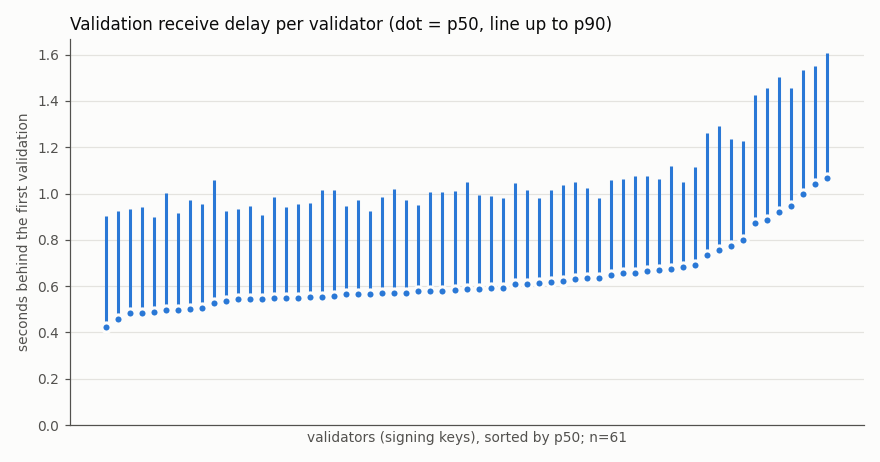
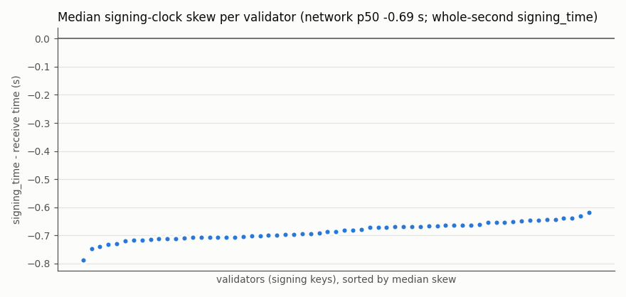
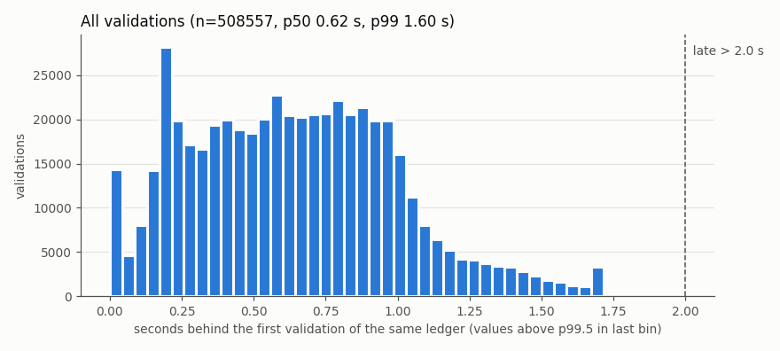

OS: Ubuntu 22.04.5 LTS | kernel 5.15.0-198-generic | python 3.10.12 | report generated 2026-10-25T22:15:24Z

Clock: systemd-timesyncd NTPSynchronized=yes, Offset: -22.527ms at report time (server <redacted-ip>, ntp.ubuntu.com). The ~0.7 s median skew below is dominated by whole-second `signing_time` truncation and transit (see README), not by this clock offset.

Collector log (`logs/collect.log`, verbatim; only the loopback admin WS of the container's own netns is named):

```
2026-10-25T15:13:15Z start window 2026-10-25T15:13:15Z -> 2026-10-25T22:13:15Z last_ledger=None vals=0 torn_bytes=0 bad_lines=0 pid=608241
2026-10-25T15:13:15Z connected (1) ws://127.0.0.1:6006/, subscribed validations,ledger
2026-10-25T16:13:17Z progress last_ledger=7474933 vals=72591 dups_dropped=0
2026-10-25T17:13:16Z progress last_ledger=7476124 vals=145242 dups_dropped=0
2026-10-25T18:13:16Z progress last_ledger=7477317 vals=218015 dups_dropped=0
2026-10-25T19:13:16Z progress last_ledger=7478509 vals=290727 dups_dropped=0
2026-10-25T20:13:16Z progress last_ledger=7479702 vals=363500 dups_dropped=0
2026-10-25T21:13:16Z progress last_ledger=7480892 vals=436090 dups_dropped=0
2026-10-25T22:13:15Z stop (window complete) last_ledger=7482080 vals=508589 dups_dropped=0
```

Raw `vl.jsonl` excerpt (first session, ledger and two val events, last line; 516928 lines, sha256 dcdad80643c0c79b60530ad96f32aaaa7ed8e300e23ca68cec1aa01ff63f4018):

```
{"ev":"session","start":1792941195.852,"resumed":false,"last_ledger":null,"last_t":null,"torn_bytes":0,"bad_lines":0,"window_end":1792966395}
{"ev":"ledger","li":7473744,"lh":"206308917C2288798D1A0BF9057E2293247A8636F13D4A92075C24808F6643C1","ct":846256400,"txn":1,"t":1792941197.864}
{"ev":"val","k":"n9L2tEqPL3oKGRpVJHTqsv1dLzEsu2Yf1usgJo5roN4o9xYvRKPD","li":7473744,"lh":"206308917C2288798D1A0BF9057E2293247A8636F13D4A92075C24808F6643C1","st":846256397,"t":1792941197.184,"mk":"nHBcnQZ9a9UjZ7hbj9zWVXZ9kTcqheUkui32YdBTpQeAsE6BxWNG","vh":"0D85429884A2F9FF7CC75C46CD0B32C947BD4C89CC632152EF835182597DC324","full":true}
{"ev":"val","k":"n9KyAznY6x5e2Mpm2GdUWtEDeXbZTUzfAbiDPzWPRdx1Ah5p2u9w","li":7473744,"lh":"206308917C2288798D1A0BF9057E2293247A8636F13D4A92075C24808F6643C1","st":846256397,"t":1792941197.221,"mk":"nHBmj7zUY2yMc9f5wgNcCuWj79BUieNmc1GG8PqiEP1tgNZZWLVM","vh":"0D85429884A2F9FF7CC75C46CD0B32C947BD4C89CC632152EF835182597DC324","full":true}
{"ev":"stop","t":1792966395.038,"reason":"window complete"}
```

Crosschecks (20 random collected ledgers each, local node + rpc.testnet.postfiat.org, hash and close_time): `logs/crosscheck-1.log` (16:16Z, inside the window) RESULT: PASS 20/20 match; `logs/crosscheck-2.log` (22:13Z, right after the window) RESULT: PASS 20/20 match. Resume drill: `logs/resume-drill-1.log` (separate output dir, does not touch this window). No node restarts or postfiatd config changes during the window.

---

# vlatency report: 7h window on pft-agent-01

Window (validated-ledger receive times, UTC): 2026-10-25T15:13:17Z .. 2026-10-25T22:13:12Z; ledgers 8337 (7473744-7482080); validations 508589 (duplicates dropped 0); validators (signing keys) 61; collector sessions 1.

Single vantage point: every latency below is when THIS node received the message. It mixes the validator's own speed with the relay path to this node. See the README for the limits.

## Network

| metric | n | p50 | p90 | p99 | max |
|---|---:|---:|---:|---:|---:|
| d_first (s behind the first validation) | 508557 | 0.62 | 1.08 | 1.60 | 3.04 |
| signing skew (s, st - receive) | 508557 | -0.69 | -0.29 | -0.17 | -0.05 |

- late share (d_first > 2.0 s): 0.07%
- validations for a non-validated hash: 0; partial (full=false): 0; for a ledger not seen validated here: 32
- close_time kinds (resolution 10 s): bumped 5817, rounded 2520. d_ct uses rounded ledgers only.

## Per validator

Sorted by d_first p50. Seconds. `skew-net` = this validator's median skew minus the network median.

| signing key | matched | span cov | d_first p50 | p90 | p99 | max | d_closed p50 | d_ct p50 | skew p50 | skew-net | late | non-val |
|---|---:|---:|---:|---:|---:|---:|---:|---:|---:|---:|---:|---:|
| `n9MtAQVaqN6vCmRy7sKDpLEMFx9BTE2ar81ZgoxhCi1wQ1VDiwdD` | 8337 | 100.00% | 0.42 | 0.90 | 1.02 | 1.90 | -0.47 | -1.37 | -0.64 | 0.05 | 0.00% | 0 |
| `n9LxzfF8DjFXbJPmLRqhN21wFXBmRxFqV5gbvFmd8vJRgE6KiHy8` | 8337 | 100.00% | 0.46 | 0.93 | 1.27 | 1.95 | -0.43 | -1.33 | -0.69 | -0.01 | 0.00% | 0 |
| `n9Kpby9UTxxKihywYkEQzJfFQraAyUo6jSJJ1PUXKYcuuAncbZvV` | 8337 | 100.00% | 0.48 | 0.93 | 1.32 | 2.21 | -0.43 | -1.33 | -0.66 | 0.02 | 0.01% | 0 |
| `n9J1jfiAsSvJJGfSGJjt3yyk26SavVZbd5VvVndv6ncYuvxSz8f8` | 8337 | 100.00% | 0.49 | 0.94 | 1.45 | 2.18 | -0.40 | -1.31 | -0.62 | 0.07 | 0.01% | 0 |
| `n9KKX2tz6pSM7XSytYAio4yiuBNgcbi9bAQ5JDxBDfB2UJQbsUcx` | 8337 | 100.00% | 0.49 | 0.90 | 1.09 | 2.21 | -0.46 | -1.33 | -0.66 | 0.02 | 0.01% | 0 |
| `n9LcH5MLndLPrns6pupa3zCQKbNRzLvnjN8WG5mGCyGvKDKLTESQ` | 8337 | 100.00% | 0.49 | 1.00 | 1.35 | 2.23 | -0.41 | -1.31 | -0.64 | 0.04 | 0.01% | 0 |
| `n9L2tEqPL3oKGRpVJHTqsv1dLzEsu2Yf1usgJo5roN4o9xYvRKPD` | 8337 | 100.00% | 0.50 | 0.91 | 1.11 | 1.72 | -0.42 | -1.32 | -0.66 | 0.03 | 0.00% | 0 |
| `n9MX1Jb7wmfoVJEcH9BUmD8turGYqhuDwkpDEkj7t6eQtwsFq81B` | 8337 | 100.00% | 0.50 | 0.97 | 1.34 | 2.42 | -0.41 | -1.30 | -0.65 | 0.03 | 0.01% | 0 |
| `n9LCvnbesKjbVgyWQCkGXAHsGP492hr9T9sTNKu7pCWPve5Si45m` | 8337 | 100.00% | 0.51 | 0.96 | 1.26 | 1.97 | -0.38 | -1.28 | -0.69 | -0.01 | 0.00% | 0 |
| `n9KeapEfbwuoD8rNSN5LgtXCrCAcYNNFi3sin8ADKiXiF6ihZxgh` | 8337 | 100.00% | 0.53 | 1.06 | 1.46 | 2.35 | -0.34 | -1.25 | -0.71 | -0.02 | 0.04% | 0 |
| `n9L65VTg7yMP9bwt7AuJ8UmcKwhFrXARVtGpDf3SvaT9JNAnZpwj` | 8337 | 100.00% | 0.54 | 0.93 | 1.08 | 2.21 | -0.41 | -1.29 | -0.70 | -0.01 | 0.01% | 0 |
| `n9Jqmo4qgU3jZM6UAKdEeUH1CsxioMVLuWPQuyjLCUuGaY2gcjTn` | 8337 | 100.00% | 0.54 | 0.93 | 1.23 | 2.27 | -0.39 | -1.30 | -0.67 | 0.01 | 0.01% | 0 |
| `n9LmsarGpd99QP6k2RHhMXRcHgBGm6hcnmGfxtPTnkFdLXGniQQX` | 8337 | 100.00% | 0.55 | 0.95 | 1.13 | 2.21 | -0.41 | -1.29 | -0.70 | -0.02 | 0.02% | 0 |
| `n9MqPuWw65ELKv2Ay4YnaJbiT47EjqWTqiFT6nKXHze5uA2nmY7a` | 8337 | 100.00% | 0.55 | 0.91 | 1.26 | 1.90 | -0.41 | -1.29 | -0.68 | 0.01 | 0.00% | 0 |
| `n9K6DwgbzchaNKiTDvEzR3Ufor1NMDemvMeNr6tkbRNgJMdtCcAt` | 8337 | 100.00% | 0.55 | 0.98 | 1.42 | 2.45 | -0.37 | -1.26 | -0.66 | 0.02 | 0.06% | 0 |
| `n9KGKWYqibyH5XpCYaEo28T23fAX1SFApyQFJDjwCWezE7yZLpMC` | 8337 | 100.00% | 0.55 | 0.94 | 1.16 | 2.21 | -0.37 | -1.27 | -0.71 | -0.02 | 0.01% | 0 |
| `n9LVjTb7AQUdVvynkfFkJDqn62z9kE2bzgqxKRefEuvK7VWaRvXH` | 8337 | 100.00% | 0.55 | 0.95 | 1.31 | 2.17 | -0.38 | -1.27 | -0.71 | -0.02 | 0.01% | 0 |
| `n9Kc1swwT6uHYMv5feRTSTwtXtQgBWxDZrWDuHQj7fBTnQaoC9ux` | 8337 | 100.00% | 0.55 | 0.96 | 1.30 | 2.24 | -0.40 | -1.29 | -0.65 | 0.04 | 0.02% | 0 |
| `n9KAfMKurkKXogwgULkQTM9NpVTqiYhpmNs96G5tmh46DhcDeDpi` | 8337 | 100.00% | 0.56 | 1.01 | 1.39 | 2.17 | -0.36 | -1.25 | -0.70 | -0.02 | 0.04% | 0 |
| `n9MgvdtyKKKYLvAFWT1qEC2Ypuy4Q4GrD6VvVS2eExwPE9Dmnbcy` | 8337 | 100.00% | 0.56 | 1.02 | 1.39 | 2.21 | -0.33 | -1.25 | -0.63 | 0.05 | 0.04% | 0 |
| `n9JbMNLnzsqks4nzc2VTrm4J5btYV2UezooidLZ4kxpA6zvdfrF3` | 8337 | 100.00% | 0.56 | 0.95 | 1.34 | 2.31 | -0.40 | -1.28 | -0.72 | -0.03 | 0.04% | 0 |
| `n9JccRshCbZ2C6TftvCeV3RwwPVzAHb8sPm5Ndyq7LSoxtWrjWYn` | 8337 | 100.00% | 0.57 | 0.97 | 1.41 | 2.41 | -0.38 | -1.27 | -0.72 | -0.03 | 0.04% | 0 |
| `n9MqVuBRbLJC9U939Mg59W9kMx9jZgenab16qmPKbZVLLCfdVMUH` | 8337 | 100.00% | 0.57 | 0.92 | 1.28 | 2.21 | -0.39 | -1.27 | -0.70 | -0.02 | 0.01% | 0 |
| `n9LCGZZSGPwte1LHLp8ZPL3Ud35qof5veBraFFRVnhipKGCta4RU` | 8337 | 100.00% | 0.57 | 0.98 | 1.39 | 2.16 | -0.39 | -1.28 | -0.66 | 0.02 | 0.01% | 0 |
| `n9LKqRAaexUXyodt8LSZi2jKF4zgtjwzPwE6mEspbnnDFRvkVbLn` | 8337 | 100.00% | 0.57 | 1.02 | 1.43 | 2.41 | -0.31 | -1.23 | -0.64 | 0.04 | 0.05% | 0 |
| `n9KUBFWUFZAEuiXRq2b9D1i1LKsNrmongGASh2FHCFmouGyShtd1` | 8337 | 100.00% | 0.57 | 0.97 | 1.24 | 2.34 | -0.37 | -1.26 | -0.67 | 0.02 | 0.02% | 0 |
| `n9Lki5Kxiqzkdh7ZAEhqThJ7bPzY4V4fQvYxoKGcGg5sBtkAfKdQ` | 8337 | 100.00% | 0.58 | 0.95 | 1.20 | 2.21 | -0.37 | -1.25 | -0.71 | -0.02 | 0.01% | 0 |
| `n9LCgdG5Koew7BsvknHLd2LHym6CfTmQdmXYmsbnfqgEXEEFaMLf` | 8337 | 100.00% | 0.58 | 1.01 | 1.41 | 2.21 | -0.32 | -1.21 | -0.69 | -0.00 | 0.01% | 0 |
| `n9MgGgByhJMxvqfCQSYA8S1Z6HnBhFveFGa4HH2rZs1wPXYrWoiN` | 8337 | 100.00% | 0.58 | 1.00 | 1.27 | 2.20 | -0.33 | -1.22 | -0.71 | -0.03 | 0.01% | 0 |
| `n9Ls8vvvKGD97aTA2LufKv3672VWv41zQSk3rCuvUYCkUzyGzVmR` | 8337 | 100.00% | 0.58 | 1.01 | 1.30 | 1.98 | -0.36 | -1.23 | -0.68 | 0.00 | 0.00% | 0 |
| `n9MSsKVYd8dbwbr8eTZkLFRAqCxVmybwv73qf9rLpM6yR8jiJ7c4` | 8337 | 100.00% | 0.59 | 1.05 | 1.41 | 2.21 | -0.32 | -1.24 | -0.67 | 0.01 | 0.04% | 0 |
| `n9K8JQsj8uJ2JfftB7dU5iMwUg8UqNpZpydNPCcE55RA2eKSVPhH` | 8337 | 100.00% | 0.59 | 0.99 | 1.40 | 2.18 | -0.36 | -1.25 | -0.67 | 0.01 | 0.02% | 0 |
| `n94NH61XnLC5wFPKGRmJoZpiZCB1Zqnd7uwCWnGKuSQUzDAf53NT` | 8337 | 100.00% | 0.59 | 0.99 | 1.35 | 2.21 | -0.36 | -1.22 | -0.68 | 0.00 | 0.01% | 0 |
| `n9KcuZKdeU1pXRJqj6QhAgiZ3dXkGScBPTQ3ZmfKGaoSjV96F4RV` | 8337 | 100.00% | 0.59 | 0.98 | 1.26 | 1.90 | -0.36 | -1.25 | -0.73 | -0.04 | 0.00% | 0 |
| `n9KMJrxhymm4HGBCdefRh5PA1o11it5DgEP7AmNy7cY76Mg7k1jg` | 8337 | 100.00% | 0.61 | 1.04 | 1.36 | 2.17 | -0.32 | -1.21 | -0.73 | -0.05 | 0.07% | 0 |
| `n9KqJak6rxyGEnaxKX3HJq1fDGZHKkaie6hFKLX67JfkGJ8XsZ5c` | 8337 | 100.00% | 0.61 | 1.02 | 1.28 | 1.98 | -0.35 | -1.22 | -0.65 | 0.03 | 0.00% | 0 |
| `n9KyAznY6x5e2Mpm2GdUWtEDeXbZTUzfAbiDPzWPRdx1Ah5p2u9w` | 8337 | 100.00% | 0.61 | 0.98 | 1.38 | 2.21 | -0.35 | -1.23 | -0.65 | 0.04 | 0.02% | 0 |
| `n9M72Hp1qapmNt192CY7hvkYDVFnJDUyJzYFaq4mohLYXKbG6W46` | 8337 | 100.00% | 0.62 | 1.01 | 1.41 | 2.40 | -0.31 | -1.20 | -0.71 | -0.03 | 0.02% | 0 |
| `n9LUBCzvvGNixQMnyGcngMVu8e618xLBxSVyg3SJVYeDkt2pRN2f` | 8337 | 100.00% | 0.62 | 1.04 | 1.43 | 2.13 | -0.31 | -1.20 | -0.65 | 0.03 | 0.05% | 0 |
| `n9JcRCDKSxEp34EUuibsFPBEAobX6zA8MxDkh3acFeP1LnRn64zR` | 8337 | 100.00% | 0.63 | 1.05 | 1.53 | 2.51 | -0.28 | -1.18 | -0.72 | -0.04 | 0.02% | 0 |
| `n9LpyNgWNyq8374vj95RGpKcdPj89EKpGNF6KMgEw3U7twYhBeWK` | 8337 | 100.00% | 0.63 | 1.02 | 1.42 | 2.39 | -0.30 | -1.21 | -0.67 | 0.02 | 0.04% | 0 |
| `n9LsL4Z6cr5TsWm7QZ9At3pbYbmpxCYQF71thEZAw7SpGnF4ie5T` | 8337 | 100.00% | 0.63 | 0.98 | 1.30 | 2.21 | -0.36 | -1.22 | -0.70 | -0.01 | 0.01% | 0 |
| `n9LxkFFZgX88RvKY2eZ3GQnhAz3Ttx9uK6Ea58vbW1v4zS9UHrj6` | 8337 | 100.00% | 0.65 | 1.06 | 1.47 | 2.35 | -0.29 | -1.20 | -0.69 | -0.01 | 0.05% | 0 |
| `n9LA23H2h2DqZWcsBHeNZ8ThXRWdy961sZy35uJVZACCdZkoVJ9q` | 8337 | 100.00% | 0.66 | 1.06 | 1.48 | 2.52 | -0.27 | -1.17 | -0.72 | -0.03 | 0.08% | 0 |
| `n9LSgTpf3EojiUon43rPhLrUeMXvJfRvdQKzPKSs2zcwW72nGTPq` | 8337 | 100.00% | 0.66 | 1.08 | 1.63 | 2.61 | -0.25 | -1.15 | -0.67 | 0.02 | 0.04% | 0 |
| `n9L4uZHvtdjRdou3vSXmkACvuBu1WffK1KFJ5EqAfZUSAkzsUK5z` | 8337 | 100.00% | 0.67 | 1.07 | 1.45 | 2.18 | -0.28 | -1.16 | -0.70 | -0.01 | 0.02% | 0 |
| `n94KXP7F2zwXzKX6YZ4N8T3KyCNrRRiXxbbKsjUviRfuWbdkUMd8` | 8337 | 100.00% | 0.67 | 1.06 | 1.48 | 2.02 | -0.27 | -1.16 | -0.67 | 0.01 | 0.01% | 0 |
| `n9MC7Riku8MLwKFGQ1YmMSg55oxPeBsEQzKAsRd6YXHuHVfcrDji` | 8337 | 100.00% | 0.67 | 1.12 | 1.45 | 2.21 | -0.24 | -1.13 | -0.67 | 0.02 | 0.01% | 0 |
| `n9KCDAwPQSNYjMYgwrt9u3ZyhoXexoXQYiuAvxEEc8ZQZEyaz3xz` | 8337 | 100.00% | 0.68 | 1.05 | 1.44 | 2.35 | -0.27 | -1.17 | -0.70 | -0.01 | 0.01% | 0 |
| `n943qDUa2nsxEm8DXX6WJyZTCRhb7LgpYxrqhYJsM3Zie47Sw4xE` | 8337 | 100.00% | 0.69 | 1.12 | 1.57 | 2.42 | -0.20 | -1.11 | -0.71 | -0.02 | 0.05% | 0 |
| `n9KBGXuNRg9ad5Y58S9R9usU6WMzMSiz9vePTFkGnCbm5BmCtjis` | 8337 | 100.00% | 0.73 | 1.26 | 1.62 | 2.38 | -0.18 | -1.08 | -0.65 | 0.04 | 0.07% | 0 |
| `n9LX3XXywjsByHqBck8NAxnDhgSBmurePQLNy2r8PnQ5p6HWJPP8` | 8337 | 100.00% | 0.76 | 1.29 | 1.66 | 2.38 | -0.17 | -1.04 | -0.66 | 0.02 | 0.07% | 0 |
| `n9Kyu2ZY1u1k4Jd5Vc7qVHrziGYswtUZPHJeyFuEFkyhsmEBNHmt` | 8337 | 100.00% | 0.78 | 1.24 | 1.64 | 2.21 | -0.18 | -1.05 | -0.67 | 0.02 | 0.05% | 0 |
| `n9KE8jzWptyDcP7z8SDUMh7mMD9aK19D3dcKtJotWFBfpH7GcVV1` | 8337 | 100.00% | 0.80 | 1.23 | 1.72 | 2.65 | -0.12 | -1.01 | -0.79 | -0.10 | 0.08% | 0 |
| `n9McuLTJ5msJMsjeEe8RJ1bnbm9taYUERu5UYCekN22NGDPYJhPk` | 8337 | 100.00% | 0.87 | 1.43 | 1.83 | 2.30 | -0.07 | -0.92 | -0.75 | -0.06 | 0.20% | 0 |
| `n9K9qcGMs72WXr1vfamHyY32TVt4vGYoEfc2D5zdgCE6c1ipEw1c` | 8337 | 100.00% | 0.88 | 1.46 | 1.81 | 2.51 | -0.04 | -0.93 | -0.71 | -0.03 | 0.14% | 0 |
| `n9Kpw7LDF6m5nX3u2Wv5nnjNrThKzD9Vm6w2MneqhHTCfFiLBV6w` | 8337 | 100.00% | 0.92 | 1.50 | 1.89 | 3.04 | 0.02 | -0.88 | -0.69 | -0.00 | 0.40% | 0 |
| `n9L6g4tXCxnUsX2JvVoSoZFiT5nkFG7Y61Eccp8gYvxN4R8UpV7R` | 8337 | 100.00% | 0.94 | 1.46 | 1.82 | 2.52 | 0.00 | -0.87 | -0.71 | -0.02 | 0.35% | 0 |
| `n9L3H6BkKSiMLBvn7AENirj7fQrZHQPtHDyyJ6S6Y4VFWFVHsanq` | 8337 | 100.00% | 1.00 | 1.53 | 1.85 | 2.52 | 0.09 | -0.80 | -0.71 | -0.03 | 0.18% | 0 |
| `n94p2zjAjJpRArrWgH5rpTbj4nisSbhM3VpiCR69hibFZFvrRPnA` | 8337 | 100.00% | 1.04 | 1.55 | 1.92 | 2.67 | 0.12 | -0.78 | -0.65 | 0.04 | 0.58% | 0 |
| `n9JZdkgbx4s5tx59XwPd7Ug25VtDArzYU7nGfSVZZMmhWpna6b2Q` | 8337 | 100.00% | 1.07 | 1.61 | 1.99 | 2.81 | 0.14 | -0.74 | -0.74 | -0.05 | 0.90% | 0 |

## Hourly (network d_first)

| hour (UTC) | n | p50 | p90 | p99 | max | late |
|---|---:|---:|---:|---:|---:|---:|
| 2026-10-25T15:00Z | 56547 | 0.59 | 1.03 | 1.51 | 2.07 | 0.01% |
| 2026-10-25T16:00Z | 72590 | 0.64 | 1.14 | 1.68 | 2.75 | 0.15% |
| 2026-10-25T17:00Z | 72773 | 0.61 | 1.03 | 1.57 | 3.04 | 0.06% |
| 2026-10-25T18:00Z | 72773 | 0.64 | 1.13 | 1.67 | 2.42 | 0.08% |
| 2026-10-25T19:00Z | 72712 | 0.62 | 1.07 | 1.56 | 2.25 | 0.01% |
| 2026-10-25T20:00Z | 72651 | 0.63 | 1.10 | 1.61 | 2.95 | 0.09% |
| 2026-10-25T21:00Z | 72529 | 0.62 | 1.06 | 1.57 | 2.52 | 0.04% |
| 2026-10-25T22:00Z | 15982 | 0.65 | 1.10 | 1.70 | 2.46 | 0.14% |

## Charts







